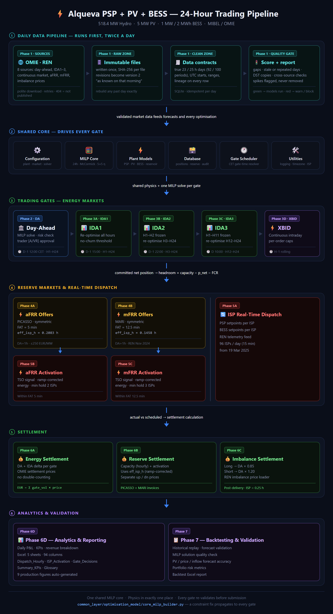

# Alqueva PSP + PV + BESS — 24-Hour Energy Trading Optimizer

Production-grade 24-hour MILP trading optimizer for the Alqueva hybrid energy plant (Portugal / MIBEL) — pumped-storage hydro, floating PV, and battery storage, bidding across DA, IDA, XBID, aFRR, and mFRR with full settlement and analytics.

[](https://github.com/Praveen-Energy-Trading/Alqueva-PSP-PV-BESS-24hr-Energy-Trading-DA-IDA-aFRR-mFRR-Optimizer/actions/workflows/tests.yml) [](https://github.com/Praveen-Energy-Trading/Alqueva-PSP-PV-BESS-24hr-Energy-Trading-DA-IDA-aFRR-mFRR-Optimizer/actions/workflows/data-pipeline.yml)

**Python 3.10+ · IBM CPLEX (HiGHS / CBC fallback) · 21 pipeline phases (daily data pipeline + 20 trading phases) · 1 shared MILP model**

**Contents:** [Pipeline Architecture](#pipeline-architecture) · [Plant](#plant) · [Market Coverage](#market-coverage) · [Quick Start](#quick-start) · [Example Run](#example-run) · [Phase Reference](#phase-reference) · [Project Structure](#project-structure) · [Outputs](#outputs) · [Design Principles](#design-principles)

---

## Pipeline Architecture

<p align="center">
  
</p>

---

## Plant

| Asset | Specification |
|-------|--------------|
| **PSP — Pumped Storage** | 4 × reversible Francis units, 129.6 MW turbine / 111.6 MW pump each → **518.4 MW generation / 446.4 MW pumping** |
| **PV — Floating Solar** | 5 MWp, commissioned 2022, temperature derate, annual degradation model |
| **BESS — Battery** | 1 MW / 2 MWh, SOC 10 %–95 %, η<sub>charge</sub> = η<sub>discharge</sub> = 0.90 |
| **Upper Reservoir** | Alqueva, 3,150 hm³ usable, head range **54.7–73.0 m** |
| **Lower Reservoir** | Pedrógão, 54 hm³ usable, binding constraint on long pumping sequences |

> **Sign convention:** generation / discharge = **+**, pumping / charging = **−**

---

## Market Coverage

| Gate | Exchange | Gate Close (CET) | Hours in Scope |
|------|----------|-----------------|----------------|
| **Day-Ahead (DA)** | OMIE | D-1 12:00 | H1–H24, all 24 hours |
| **IDA1** | OMIE SIDC | D-1 15:00 | H1–H24 |
| **IDA2** | OMIE SIDC | D-1 22:00 | H3–H24 |
| **IDA3** | OMIE SIDC | D 10:00 | H12–H24 &nbsp;(H1–H11 frozen) |
| **XBID** | SIDC continuous | H-1 rolling | Open hours only |
| **aFRR** | PICASSO | DA + 1 h | Symmetric ±MW, FAT = 5 min, cap ≤ 250 EUR/MW |
| **mFRR** | MARI | DA + 1 h | Symmetric ±MW, FAT = 12.5 min |
| **Imbalance** | REN | Post-delivery | Long → DA×0.85, Short → DA×1.20 |

> [!NOTE]
> **Regulatory dates hard-coded in `config/market.yaml`:**
> SIDC 6→3 sessions from **13 Jun 2024**, ISP 15-min (96/day) from **19 Mar 2025**, PICASSO harmonised **4 Dec 2024**, MARI/REN joined **27 Nov 2024**, FCR is mandatory & non-remunerated — modelled as reserved headroom only, never a market gate.

---

## Quick Start

```bash
# 1. Install dependencies
pip install -r requirements.txt

# 2. Run full pipeline for tomorrow (AUTO mode, synthetic prices — no CPLEX needed)
python run_production.py

# 3. Run for a specific date
python run_production.py --date <YYYY-MM-DD>

# 4. Backtest mode — fully automated, no live APIs
python run_production.py --date <YYYY-MM-DD> --auto --synthetic

# 5. Resume from a specific phase after a crash
python run_production.py --date <YYYY-MM-DD> --from-phase realtime

# 6. Run only selected phases
python run_production.py --date <YYYY-MM-DD> --only da,afrr,mfrr

# 7. Validate config and imports without executing anything
python run_production.py --dry-run

# 8. Daily data pipeline on its own — offline demo on a real 25-hour day, no network, no licence needed
python phase_1_data_pipeline/run_data_pipeline.py --demo
```

Phase 1 (the daily data pipeline) runs first inside `run_production.py`; see [`phase_1_data_pipeline/README.md`](phase_1_data_pipeline/README.md).

> [!TIP]
> **No CPLEX licence?** The pipeline auto-selects **HiGHS** (free, bundled via `highspy`) or CBC. Set solver preference in `config/solver.yaml`. Everything works out of the box.

---

## Example Run

Real output of a full pipeline run for delivery on 10 Oct 2026, solved with IBM CPLEX on real OMIE and REN market data (`python run_production.py --auto`). All 19 phases passed; the rolling-backtest phase 7E was skipped for this run with `--no-backtest`.

```
  PHASE                                          STATUS     TIME  NOTE
  --------------------------------------------------------------------------------
  1      Day-Ahead bidding  (OMIE DA)           [ OK  ]  232.23s
  2      aFRR capacity offer  (PICASSO/REN)     [ OK  ]  109.20s
  3      mFRR capacity offer  (MARI)            [ OK  ]   36.67s  energy-only, no capacity payment
  4A     IDA1 intraday re-optimisation          [ OK  ]   99.70s
  4B     IDA2 intraday re-optimisation          [ OK  ]   41.03s
  4C     IDA3 intraday re-optimisation          [ OK  ]   41.94s
  4D/W1  XBID continuous  (D-1 18:30)           [ OK  ]   39.50s
  4D/W2  XBID continuous  (D-1 22:30)           [ OK  ]    5.80s
  4D/W3  XBID continuous  (D  03:00)            [ OK  ]    5.29s
  4D/W4  XBID continuous  (D  06:00)            [ OK  ]    5.29s
  4D/W5  XBID continuous  (D  09:30)            [ OK  ]    5.96s
  4D/W6  XBID continuous  (D  12:00)            [ OK  ]    5.53s
  5A     RT dispatch simulation  (96 ISPs)      [ OK  ]    0.02s
  5B     aFRR activation response               [ OK  ]    0.13s
  5C     mFRR activation response               [ OK  ]    0.12s
  6A     Energy settlement  (DA / IDA)          [ OK  ]    3.15s
  6B     Reserve settlement  (aFRR / mFRR)      [ OK  ]    0.46s
  6C     Imbalance settlement  (REN balance)    [ OK  ]    0.50s
  6D     Analytics + KPI report + Excel         [ OK  ]    4.26s

  PIPELINE COMPLETE
  19 passed   1 skipped   0 warnings   0 failed   (636.8s total)
```

(The first run of the day is slow because every forecasting model is refreshed; the solves themselves take about 3 s each.)

### One-year backtest at real prices

Rolling backtest over 1 Oct 2025 to 30 Sep 2026: every day is solved with forecast prices, then valued at the prices OMIE and REN actually published. Full report: [docs/results/backtest_2025-10-01_365d.xlsx](docs/results/backtest_2025-10-01_365d.xlsx).

| Measure | Result |
|---|---|
| Days feasible / passing the physical-constraint checker | 365 / 365 and 365 / 365 |
| Days valued at real prices | 365 / 365 |
| Average solve time | 2.8 s |
| Day-ahead price forecast error (average absolute) | EUR 18.0 / MWh |
| Average realised daily P&L (DA energy + aFRR capacity) | EUR 400,036 |
| of which DA energy / aFRR capacity / mFRR capacity | EUR 367,750 / 32,286 / 0 |
| Std. dev. of daily P&L, worst day, best day | EUR 219,155; -35,643; 911,758 |
| Profit-at-Risk VaR 95% / CVaR 95% (historical) | EUR 25,022 / 13,422 |
| Profit-at-Risk VaR 99% / CVaR 99% (historical) | EUR 9,023 / -2,622 |
| Bootstrap VaR 95% (10,000 resamples) | EUR 25,990 +/- 7,381 |

> [!NOTE]
> This table was produced before the 65 / 20 / 14 / 1 allocation (aFRR cap 95 MW, mFRR 20% of the leftover, no idle rule). Re-run `python phase_7_backtesting_and_validation/run_backtest.py` to refresh it with the current settings.

VaR and CVaR here are the low tail of daily **profit** (the 5th percentile day), not a loss. The year is uneven because real prices are: February 2026 averaged EUR 11/MWh, September 2026 EUR 144/MWh. These figures are an **upper bound**, not a forecast of plant earnings; see Modelling Assumptions below.

> [!NOTE]
> **On robustness:** the pipeline blocks a bid it cannot physically guarantee. If intraday re-optimisation leaves too little pumping capacity to refill the upper reservoir by the end of the day, the solver reports infeasibility and the run aborts rather than submitting an unproven bid (`SolveError`, PR-13). That is intended behaviour, not a defect.

---

## Phase Reference

| Phase | Entry Point | What It Does |
|-------|------------|--------------|
| **Phase 1, Data** | `run_data_pipeline.py` | Daily: download new OMIE / REN files into an immutable raw zone, validate against data contracts into a clean zone, quality checks + daily score + report, pass/fail gate ([details](phase_1_data_pipeline/README.md)) |
| **Phase 2, DA** | `run_da.py` | MILP solve → physical check → risk check → trader approval → position save |
| **Phase 3A, IDA1** | `run_ida1.py` | Re-optimise H1–H24, no-churn threshold, SIDC delta bids |
| **Phase 3B, IDA2** | `run_ida2.py` | H1–H2 frozen, re-optimise H3–H24 |
| **Phase 3C, IDA3** | `run_ida3.py` | H1–H11 frozen, re-optimise H12–H24 |
| **Phase 3D/W1, XBID** | `run_xbid.py` | Continuous intraday check window 1 (D-1 18:30), per-order caps |
| **Phase 3D/W2, XBID** | `run_xbid.py` | Continuous intraday check window 2 (D-1 22:30), per-order caps |
| **Phase 3D/W3, XBID** | `run_xbid.py` | Continuous intraday check window 3 (D 03:00), per-order caps |
| **Phase 3D/W4, XBID** | `run_xbid.py` | Continuous intraday check window 4 (D 06:00), per-order caps |
| **Phase 3D/W5, XBID** | `run_xbid.py` | Continuous intraday check window 5 (D 09:30), per-order caps |
| **Phase 3D/W6, XBID** | `run_xbid.py` | Continuous intraday check window 6 (D 12:00), per-order caps |
| **Phase 4A, aFRR** | `run_afrr.py` | Capacity offers, PICASSO, FAT 5 min, `eff_isp_h` = 0.2083 h |
| **Phase 4B, mFRR** | `run_mfrr.py` | Capacity offers, MARI, FAT 12.5 min, `eff_isp_h` = 0.1458 h |
| **Phase 5A, Real-Time** | `run_realtime.py` | 96 ISPs/day, PSP + BESS setpoints, REN telemetry feed |
| **Phase 5B, aFRR Act.** | `run_afrr_activation.py` | TSO activation → ramp-corrected energy, min hold 2 ISPs |
| **Phase 5C, mFRR Act.** | `run_mfrr_activation.py` | TSO activation → ramp-corrected energy, min hold 3 ISPs |
| **Phase 6A, Energy** | `run_energy_settlement.py` | DA + IDA delta per gate, OMIE prices, no double-counting |
| **Phase 6B, Reserve** | `run_reserve_settlement.py` | Capacity (hourly) + activation, `eff_isp_h` ramp-corrected, PICASSO + MARI |
| **Phase 6C, Imbalance** | `run_imbalance_settlement.py` | Long→DA×0.85, Short→DA×1.20, REN imbalance prices |
| **Phase 6D, Analytics** | `run_analytics.py` | Daily P&L, KPIs, 5-sheet Excel report, 9 production figures |
| **Phase 7E, Rolling backtest** | `rolling_backtest.py` | Runs after every pipeline: backtests each new completed day at real prices, refreshes late-published days, re-values the actual bids, updates the 1-year Profit-at-Risk report |
| **Phase 7, Backtest** | `run_backtest.py` | Full 1-year real-price replay (seeds the rolling backtest), forecast validation, MILP quality, Profit-at-Risk on realized P&L |

---

## Project Structure

<details>
<summary><b>Click to expand — full file-level tree, every .py file with inline description</b></summary>

```
Alqueva-PSP-PV-BESS-24hr-Energy-Trading-DA-IDA-aFRR-mFRR-Optimizer/
│
├── run_production.py                             # ◄ Master orchestrator — all 21 phases (phase 1 = data pipeline)
│
├── common_layer/                                 # Shared foundation — imported by every phase
│   ├── configuration/
│   │   ├── config_loader.py                      #   load_config() → AppConfig
│   │   ├── market_config.py                      #   MarketConfig dataclass
│   │   ├── plant_config.py                       #   PlantConfig dataclass
│   │   └── solver_config.py                      #   SolverConfig dataclass
│   │
│   ├── optimisation_model/
│   │   ├── core_milp_builder.py                  #   CoreModelMeta, build_milp() — ONE model for all gates
│   │   ├── core_milp_solver.py                   #   solve_milp(), SolveError — CPLEX → HiGHS → CBC
│   │   ├── ida_reoptimiser.py                    #   optimise_ida() — freeze hours, re-solve
│   │   ├── reserve_offer_builder.py              #   build_afrr_offers(), build_mfrr_offers()
│   │   ├── activation_ramp_tracker.py            #   ramp-corrected eff_isp_h for settlement
│   │   └── reserve_activation.py                 #   reserve activation helpers
│   │
│   ├── physical_plant_models/
│   │   ├── psp_turbine_pump_model.py             #   PSPModel, UnitDispatch (4 Francis units)
│   │   ├── pv_production_model.py                #   PVModel (5 MWp, temperature derate, degradation)
│   │   ├── bess_model.py                         #   BESSModel, BESSDispatch (1 MW / 2 MWh)
│   │   ├── reservoir_model.py                    #   ReservoirModel (Alqueva + Pedrógão)
│   │   ├── fcr_headroom_model.py                 #   FCRHeadroomModel (reserved — never sold)
│   │   └── reservoir_activation_checker.py       #   validates long-pumping sequences
│   │
│   ├── database/
│   │   ├── position_store.py                     #   PositionStore → runtime/db/positions.db
│   │   ├── reserve_store.py                      #   ReserveStore → runtime/db/reserve.db
│   │   ├── realtime_store.py                     #   DeliveryStore, ActivationStore → realtime.db
│   │   ├── component_store.py                    #   ComponentStore → runtime/components/<date>.json
│   │   ├── audit_store.py                        #   AuditStore (read-only) → audit_<date>.jsonl
│   │   └── schema_validator.py                   #   input schema validation
│   │
│   ├── data_layer/                               #   Phase 1 library: market data in three zones
│   │   ├── calendar.py                           #   true market time: UTC starts, 23/25 h and 92/100-period days
│   │   ├── regimes.py                            #   dated market-rule changes (config/market_regimes.yaml)
│   │   ├── raw_store.py                          #   immutable raw zone: SHA-256, versions, as-of reads
│   │   ├── parsers.py                            #   OMIE / REN files → tidy tables (true periods)
│   │   ├── contracts.py                          #   data contracts: structure, calendar, ranges, freshness
│   │   ├── clean_store.py                        #   clean zone (SQLite) with lineage per row
│   │   ├── fetchers.py                           #   polite HTTP: pacing, retries, 404 = not published
│   │   └── ingest.py                             #   idempotent load, load log, rebuild from raw
│   │
│   ├── data_quality/                             #   Phase 1 library: checks, score, gate
│   │   ├── checks.py                             #   gaps, stale/duplicate days, DST copies, cross-source, spikes (info)
│   │   ├── scoring.py                            #   daily 0–100 score and the pass/fail gate
│   │   ├── imputation.py                         #   per-variable fill rules that never look forward
│   │   ├── provenance.py                         #   live / synthetic labels
│   │   ├── report.py                             #   Markdown quality report
│   │   └── runner.py                             #   run all, store results, require_green()
│   │
│   ├── market_analysis/                          #   forecasting programme, Phase 4: exploratory analysis
│   │   ├── panel.py                              #   all price series on one hourly UTC grid
│   │   ├── seasonality.py, dependence.py         #   variance decomposition, ACF, stationarity, ARCH
│   │   ├── breaks.py                             #   event tests with placebo years, data-driven changepoints
│   │   ├── extremes.py, relationships.py         #   spikes, negative prices, spreads, correlations
│   │   └── sample_size.py, figures.py, run.py    #   effective sample size, representativeness, figures
│   │
│   ├── forecast_formulation/                     #   Phase 5: how each target is posed
│   │   ├── transforms.py                         #   asinh transform for negative prices, mean re-transform
│   │   ├── targets.py, coherence.py              #   level/spread targets; hourly and 15-minute agree
│   │   └── evidence.py                           #   the measurements behind each choice
│   │
│   ├── forecast_evaluation/                      #   Phase 6: one contract to score any forecaster
│   │   ├── asof.py, folds.py                     #   as-of view (no leakage by construction), rolling-origin folds
│   │   ├── metrics.py, dm.py                     #   SSE / MAE / RMSE, Diebold-Mariano test
│   │   ├── forecasters.py, tree_models.py        #   interface; decision tree, random forest, GBM, XGBoost, LightGBM
│   │   ├── tuning.py                             #   Phase 9: nested, time-aware hyper-parameter search per fold
│   │   ├── ensemble.py                           #   Phase 9: mean, median, trimmed mean, error-weighted combinations
│   │   └── guards.py, backtest.py, runner.py     #   locked test period, leakage check, run and report
│   │
│   ├── feature_engineering/                      #   Phase 7: features with written availability
│   │   ├── calendar.py                           #   PT/ES holidays, bridge days, DST, market rules
│   │   ├── catalogue.py, builder.py              #   catalogue, derived availability, one builder for train/serve
│   │   └── store.py, selection.py                #   versioned feature store, stability-checked selection
│   │
│   ├── gate_scheduler/
│   │   ├── gate_scheduler.py                     #   GateScheduler — CET gate-time resolver
│   │   └── gate_trigger_spec.py                  #   trigger definitions from market.yaml
│   │
│   └── utilities/
│       ├── audit_logger.py                       #   AuditLogger — append-only JSONL trail
│       ├── timezone_utils.py                     #   CET (OMIE) ↔ WET/CET (plant) conversions
│       ├── date_utils.py                         #   delivery date parsing, D-1 calculations
│       └── logging_utils.py                      #   phase-prefixed logger setup
│
├── phase_1_data_pipeline/                        # ── Phase 1, daily data pipeline ──────────
│   ├── run_data_pipeline.py                      #   ingest → clean → quality → gate (CLI, --demo, run_production hook)
│   ├── demo.py                                   #   offline stand-in for the 8 sources (real saved 25-hour day)
│   ├── README.md                                 #   flow diagram, zones, how to read the report
│   └── schedule/                                 #   Windows Task Scheduler script, crontab example
│
├── phase_2_da_day_ahead_bidding/                 # ── Phase 2, Day-Ahead ─────────────────────
│   ├── run_da.py                                 #   entry point
│   ├── da_price_pv_inflow_forecasting/
│   │   ├── da_price_forecaster.py                #   ML DA price forecast
│   │   ├── da_price_train_val_test.py
│   │   ├── pv_power_forecaster.py                #   PV production forecast
│   │   ├── pv_train_val_test.py
│   │   ├── reservoir_inflow_forecaster.py        #   natural inflow forecast
│   │   ├── reservoir_inflow_train_val_test.py
│   │   ├── omie_da_price_loader.py               #   live OMIE DA price loader
│   │   └── ml_train_val_test_common.py           #   shared ML utilities
│   ├── da_bid_formatting/
│   │   ├── da_bid_formatter.py                   #   formats OMIE bid payload
│   │   └── da_bid_checker.py                     #   physical bid validation
│   ├── risk_and_bid_validation/
│   │   └── pre_trade_risk_checker.py             #   pre-trade risk limits
│   └── trader_approval/
│       └── trader_approval_prompt.py             #   [A]/[R] interactive prompt
│
├── phase_3a_ida1_intraday_auction_1/             # ── Phase 3A, IDA1 ──────────────────────
│   ├── run_ida1.py                               #   entry point
│   ├── ida1_price_forecasting/
│   │   ├── ida1_price_forecaster.py
│   │   ├── ida1_price_train_val_test.py
│   │   └── omie_ida1_price_loader.py
│   ├── ida1_milp_reoptimiser/
│   │   └── ida1_reoptimiser.py                   #   freeze DA, re-solve H1–H24
│   └── ida1_bid_formatting/
│       └── ida1_bid_formatter.py                 #   SIDC delta bid payload
│
├── phase_3b_ida2_intraday_auction_2/             # ── Phase 3B, IDA2 ──────────────────────
│   ├── run_ida2.py
│   ├── ida2_price_forecasting/
│   │   ├── ida2_price_forecaster.py
│   │   ├── ida2_price_train_val_test.py
│   │   └── omie_ida2_price_loader.py
│   ├── ida2_milp_reoptimiser/
│   │   └── ida2_reoptimiser.py                   #   freeze H1–H2, re-solve H3–H24
│   └── ida2_bid_formatting/
│       └── ida2_bid_formatter.py
│
├── phase_3c_ida3_intraday_auction_3/             # ── Phase 3C, IDA3 ──────────────────────
│   ├── run_ida3.py
│   ├── ida3_price_forecasting/
│   │   ├── ida3_price_forecaster.py
│   │   ├── ida3_price_train_val_test.py
│   │   └── omie_ida3_price_loader.py
│   ├── ida3_milp_reoptimiser/
│   │   └── ida3_reoptimiser.py                   #   freeze H1–H11, re-solve H12–H24
│   └── ida3_bid_formatting/
│       └── ida3_bid_formatter.py
│
├── phase_3d_xbid_continuous_intraday/            # ── Phase 3D, XBID ──────────────────────
│   ├── run_xbid.py
│   ├── xbid_price_forecasting/
│   │   ├── xbid_price_forecaster.py
│   │   ├── xbid_price_train_val_test.py
│   │   └── xbid_price_loader.py                  #   OMIE continuous-intraday price loader
│   ├── xbid_milp_optimiser/
│   │   └── xbid_optimiser.py                     #   per-order caps, H-1 rolling
│   └── xbid_bid_formatting/
│       └── xbid_bid_formatter.py
│
├── phase_4a_afrr_automatic_frequency_reserve/    # ── Phase 4A, aFRR ──────────────────────
│   ├── run_afrr.py
│   ├── afrr_price_forecasting/
│   │   ├── afrr_price_forecaster.py
│   │   ├── afrr_price_train_val_test.py
│   │   └── picasso_afrr_price_loader.py          #   PICASSO live price loader
│   └── afrr_reserve_offer_builder/
│       ├── afrr_offer_builder.py                 #   headroom → symmetric up/dn offers
│       └── afrr_offer_checker.py                 #   FAT deliverability, cap ≤ 250 EUR/MW
│
├── phase_4b_mfrr_manual_frequency_reserve/       # ── Phase 4B, mFRR ──────────────────────
│   ├── run_mfrr.py
│   ├── mfrr_price_forecasting/
│   │   ├── mfrr_price_forecaster.py
│   │   ├── mfrr_price_train_val_test.py
│   │   └── mari_mfrr_price_loader.py             #   MARI live price loader
│   └── mfrr_reserve_offer_builder/
│       ├── mfrr_offer_builder.py
│       └── mfrr_offer_checker.py
│
├── phase_5a_isp_real_time_dispatch/              # ── Phase 5A, Real-Time ─────────────────────
│   ├── run_realtime.py
│   ├── isp_setpoint_dispatch/
│   │   ├── psp_setpoint_dispatcher.py            #   PSP unit setpoints per ISP
│   │   └── bess_setpoint_dispatcher.py           #   BESS setpoints per ISP
│   ├── isp_activation_tracking/
│   │   └── isp_position_tracker.py               #   scheduled vs actual per ISP
│   └── telemetry/
│       └── ren_isp_signal_loader.py              #   REN telemetry feed
│
├── phase_5b_afrr_activation_response/            # ── Phase 5B, aFRR Activation ────────────────
│   ├── run_afrr_activation.py
│   ├── afrr_setpoint_dispatch/
│   │   └── afrr_activation_handler.py            #   ramp, min hold 2 ISPs, eff_isp_h
│   └── afrr_activation_tracking/
│       └── afrr_activation_logger.py
│
├── phase_5c_mfrr_activation_response/            # ── Phase 5C, mFRR Activation ────────────────
│   ├── run_mfrr_activation.py
│   ├── mfrr_setpoint_dispatch/
│   │   └── mfrr_activation_handler.py            #   ramp, min hold 3 ISPs, eff_isp_h
│   └── mfrr_activation_tracking/
│       └── mfrr_activation_logger.py
│
├── phase_6a_da_ida_settlement/                   # ── Phase 6A, Energy Settlement ───────────────
│   ├── run_energy_settlement.py
│   └── energy_settlement_calculation/
│       ├── da_settlement_calculator.py           #   DA volume × OMIE settlement price
│       ├── ida_settlement_calculator.py          #   IDA delta per gate, no double-counting
│       └── omie_settlement_price_loader.py       #   final OMIE settlement prices
│
├── phase_6b_reserve_settlement/                  # ── Phase 6B, Reserve Settlement ──────────────
│   ├── run_reserve_settlement.py
│   └── reserve_settlement_calculation/
│       ├── afrr_settlement_calculator.py         #   capacity (hourly) + activation, eff_isp_h
│       ├── mfrr_settlement_calculator.py         #   reuses generic settle_reserve()
│       └── ren_reserve_settlement_loader.py      #   PICASSO + MARI invoice loader
│
├── phase_6c_imbalance_settlement/                # ── Phase 6C, Imbalance Settlement ────────────
│   ├── run_imbalance_settlement.py
│   ├── imbalance_price_and_volume/
│   │   ├── imbalance_volume_calculator.py        #   actual − scheduled per ISP
│   │   └── ren_imbalance_price_loader.py         #   REN post-delivery prices
│   └── imbalance_settlement_calculation/
│       └── imbalance_settlement_calculator.py    #   long→DA×0.85, short→DA×1.20
│
├── phase_6d_analytics_and_reporting/             # ── Phase 6D, Analytics ─────────────────────
│   ├── run_analytics.py
│   ├── analytics_and_kpis/
│   │   ├── daily_pnl_calculator.py               #   compute_daily_pnl()
│   │   ├── revenue_breakdown_analyzer.py         #   revenue_shares() by market stream
│   │   ├── kpi_reporter.py                       #   compute_kpis() — 10 KPI sections
│   │   └── operational_analytics.py
│   └── daily_excel_reports/
│       ├── daily_report_exporter.py              #   export_daily_report() → .xlsx
│       ├── dispatch_sheet_builder.py             #   Dispatch_Hourly (94 cols)
│       └── summary_kpi_builder.py                #   Summary_KPIs sheet
│
├── phase_7_backtesting_and_validation/           # ── Phase 7, Backtesting ─────────────────────
│   ├── run_backtest.py
│   ├── backtest_engine/
│   │   ├── backtest_runner.py                    #   historical date-range replay
│   │   ├── rolling_backtest.py                   #   phase 7E: rolling 1-year backtest
│   │   ├── live_bid_resettlement.py              #   actual bids re-valued at real prices
│   │   └── historical_data_loader.py             #   load historical prices / inflows
│   ├── forecast_and_model_validation/
│   │   ├── price_forecast_validator.py           #   DA / IDA price forecast accuracy
│   │   ├── pv_forecast_validator.py              #   PV production forecast accuracy
│   │   └── milp_solution_quality_checker.py      #   MIP gap, feasibility, solve time
│   ├── risk_analytics/
│   │   └── portfolio_risk_metrics.py             #   Profit-at-Risk: VaR / CVaR of realized P&L
│   └── backtest_excel_reports/
│       └── backtest_report_exporter.py
│
├── figures/                                      # ── 9 Production Figures ───────────────────────────────
│   └── __init__.py                               #   generate(date) → all 9 figures at 600 DPI
│
├── config/                                       # ── Configuration ─────────────────────────────────────
│   ├── market.yaml                               #   gate times, IDA dates, ISP, FAT, bid limits
│   ├── plant.yaml                                #   PSP / PV / BESS / reservoir, head model
│   ├── solver.yaml                               #   CPLEX → HiGHS → CBC, MIP gap, time limits
│   └── run.yaml                                  #   date, mode, data source, phase flags
│
├── tests/                                        # ── Test Suite (pytest) ──────────────────────────────
│   ├── conftest.py                               #   shared fixtures
│   ├── test_e2e_chain.py                         #   end-to-end pipeline chain
│   ├── test_milp_physics.py                      #   MILP constraint physics
│   ├── test_ida_frozen.py                        #   IDA hour-freezing logic
│   ├── test_settlement.py                        #   settlement calculations
│   ├── test_reserve_checker.py                   #   reserve offer validation
│   ├── test_reserve_market_deep.py               #   deep reserve market tests
│   ├── test_reserve_hidden_invariants.py         #   PR-11 no-double-selling invariants
│   ├── test_reserve_realtime_delivery.py         #   activation + delivery chain
│   ├── test_checker_negative.py                  #   negative / edge-case physical checks
│   └── test_bug_regressions.py                   #   regression suite
│
├── runtime/                                      # ── Auto-created at first run ────────────────────────
│   ├── db/
│   │   ├── positions.db                          #   SQLite — energy positions (DA, IDA, XBID)
│   │   ├── reserve.db                            #   SQLite — aFRR / mFRR capacity offers
│   │   └── realtime.db                           #   SQLite — per-ISP delivery & activations
│   ├── audit/
│   │   └── audit_YYYY-MM-DD.jsonl                #   append-only audit trail (one JSON per event)
│   ├── components/
│   │   └── components_YYYY-MM-DD.json            #   per-component DA dispatch results
│   └── reports/
│       └── daily_report_YYYY-MM-DD.xlsx          #   5-sheet Excel report
│
├── docs/                                         # ── Architecture Diagrams ─────────────────────────────
│   ├── pipeline_architecture.html                #   editable source of the diagram (labels, phase numbers)
│   ├── pipeline_architecture.png                 #   pipeline diagram (2× retina, 940 px)
│   └── pipeline_architecture.svg                 #   same diagram wrapped as SVG (render: tools/render_pipeline_diagram.py)
│
├── tools/                                        # ── Data maintenance ──────────────────
│   ├── ingest_market_data.py                     #   backfill / rebuild the raw and clean zones for a date range
│   ├── run_data_quality.py                       #   quality checks + gate on the clean zone (exit 1 = red)
│   ├── run_market_analysis.py                    #   Phase 4 tables and figures
│   ├── run_formulation_evidence.py               #   Phase 5 measurements
│   ├── evaluate_forecaster.py                    #   Phase 6: score the tree models (or any forecaster) the same way
│   ├── run_feature_selection.py                  #   Phase 7: stability-checked feature selection
│   ├── run_schedule_comparison.py                #   Phase 9: calibration-window length and retraining frequency
│   ├── render_pipeline_diagram.py                #   re-render docs/pipeline_architecture.png/.svg from the HTML
│   └── rebuild_real_market_history.py            #   rebuild all price history from OMIE / REN
│
└── requirements.txt                              # pip install -r requirements.txt
```

</details>

---

## Outputs

### 9 Production Figures — `figures/output/`, 600 DPI

| # | Filename | Description |
|---|----------|-------------|
| 1 | `fig01_dispatch_profile.png` | DA net position (MWh) + DA price (EUR/MWh) — bar + line overlay |
| 2 | `fig02_soc_trajectory.png` | BESS state of charge (% of 2 MWh), 10 %/95 % bounds, step plot |
| 3 | `fig03_revenue_waterfall.png` | Revenue by stream — DA, IDA+XBID, aFRR, mFRR, Imbalance — stacked bar |
| 4 | `fig04_reserve_capacity.png` | aFRR + mFRR capacity offered (MW up/dn per hour), dual subplots |
| 5 | `fig05_gate_position_comparison.png` | Position evolution DA → IDA1 → IDA2 → IDA3 → XBID — line plot |
| 6 | `fig06_intraday_reoptimisation.png` | DA vs final committed position, IDA+XBID delta bar overlay |
| 7 | `fig07_psp_dispatch.png` | PSP turbine / pump MW schedule vs DA price — bar + line |
| 8 | `fig08_pv_bess_flow.png` | PV disposition (used / to-BESS / curtailed) + BESS power — dual subplots |
| 9 | `ops_board.png` | 3×3 operations dashboard — dispatch, SoC, KPIs, positions, aFRR, mFRR, P&L |

### 5-Sheet Excel Report — `runtime/reports/daily_report_<date>.xlsx`

| Sheet | Cols | Contents |
|-------|------|----------|
| **Dispatch_Hourly** | 94 | Hour-by-hour schedule — PSP units, BESS, PV, reservoir, head, all gate positions |
| **ISP_Activation** | — | Per-ISP (15 min) aFRR / mFRR activated MW with ramp-corrected energy |
| **Gate_Decisions** | — | DA → IDA1 → IDA2 → IDA3 → XBID position evolution and P&L per gate |
| **Summary_KPIs** | — | 10 KPI sections — revenue, dispatch, reserves, imbalance, solver quality, risk |
| **Glossary** | — | Variable definitions, units, and specification cross-references |

---

## Design Principles

| Principle | Implementation |
|-----------|----------------|
| **One MILP, all gates** | `core_milp_builder.py` owns all physics; gates change only price inputs and frozen-hour mask |
| **No double-selling** | `reserve_offer_builder.py` subtracts committed `p_net` before computing headroom (PR-11) |
| **Audit trail on every action** | `AuditLogger` writes one JSONL record per solve / position save / approval / submission |
| **Physical validation first** | Each phase runs a checker (mode exclusivity, SOC, reservoir, FAT) before any market call |
| **Timezone-correct** | Gate times in CET (Madrid), plant timestamps in WET/CET (Lisbon), DST handled automatically |
| **Solver resilience** | CPLEX → HiGHS → CBC fallback, `SolveError` raised if no feasible solution within time limit |
| **Fully restartable** | `--from-phase` resumes any run from any phase without re-running earlier phases |

## Modelling Assumptions

The P&L figures are an optimistic, price-taker estimate, not a forecast of what the plant would earn. What is assumed (all in `config/market.yaml`):

| Assumption | Setting | Why |
|---|---|---|
| **Price-taker** | Bids never move the clearing price | Standard for a single-asset optimiser; real volumes would have some market impact |
| **Replica allocation** | 65% DA energy / 20% aFRR / 14% mFRR / 1% FCR of the 524.4 MW plant | A fixed replica split, checked against REN's observed secondary-reserve band (~280 MW). Real shares change every 15 minutes |
| **aFRR band cap** | `afrr.max_offer_up/dn_mw = 105` (20%) | Without a cap the plant sold ~±250 MW of band every hour, more than Portugal's whole requirement. 105 MW is ~37% of the observed band. No aFRR is offered while the plant is idle (`afrr.require_synchronised_unit`) |
| **mFRR size** | `mfrr.max_offer_up/dn_mw = 74` (14%), all leftover headroom offered | mFRR is a legal obligation for large generators (ROR Art. 49(5)(c)) |
| **mFRR capacity** | `mfrr.capacity_payment = true` (default): a labelled **future scenario** | The daily mFRR band is required from Apr 2027 (MPGGS Ch. XVI) and is paid here at the real aFRR band price. Today's paid band is a quarterly/monthly auction won by consumers; set `false` for today's rules (energy-only, EUR 0) |
| **Natural inflow** | All of it can be turbined | Irrigation (EFMA) and environmental-flow withdrawals are not deducted, so DA energy revenue is an upper bound |
| **Activation / imbalance** | Simulated, not backtested at real prices | No real REN activation-volume (SCADA) source is available |

## Market Sequence and Reserve Allocation

The Portuguese grid-operator rulebook (MPGGS, ERSE Directive 9/2025, Art. 80(3)) fixes the order of the day, and the pipeline follows it: **DA → aFRR band → mFRR band → IDA1 → IDA2 → IDA3 → XBID**. DA energy is committed first, and reserves are offered from the headroom the schedule leaves; the intraday stages keep that reserve capacity free.

- **No fixed percentage.** The grid operator sets the national aFRR/mFRR need (inelastic); plants win a share in a merit-order auction, paid the last accepted price. See [docs/Reserve_Allocation_Interview_Answer.md](docs/Reserve_Allocation_Interview_Answer.md) for the rules with article numbers.
- **Clock hours of the aFRR/mFRR band markets** are set in a separate REN notice ("Aviso do GGS") and are not in the rulebook, so they remain an estimate in `config/market.yaml`.
- **Go-live dates (rulebook Art. 452–453):** national aFRR platform by 30 Jun 2026, PICASSO integration by 31 Oct 2026, daily mFRR band market by 1 Apr 2027. Paid mFRR capacity does exist today as quarterly/monthly ERSE auctions, but they reserve at least 75% of the awarded volume for consumption installations (in the Q4-2026 auction 13 industrial consumers took 165 of 180 MW) and cannot be modelled in a daily pipeline, so mFRR capacity is shown as a labelled future-band scenario (paid at the aFRR band price) and can be switched to energy-only.
- Detailed step-by-step sizing with a real run: [docs/aFRR_mFRR_Reserve_Sizing_Concept.md](docs/aFRR_mFRR_Reserve_Sizing_Concept.md).

