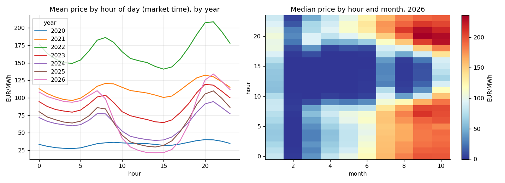
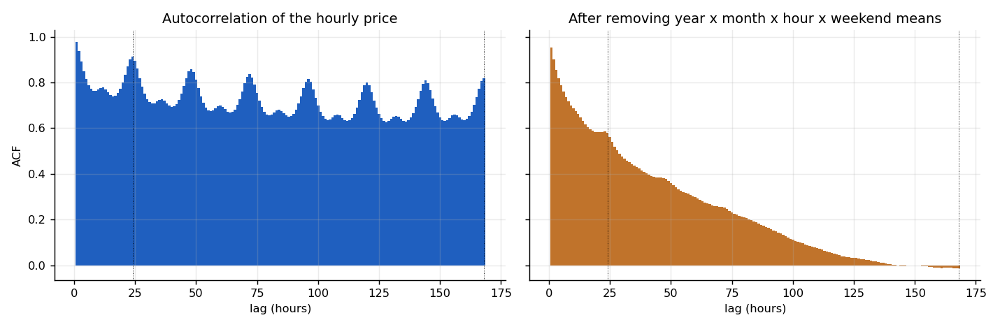
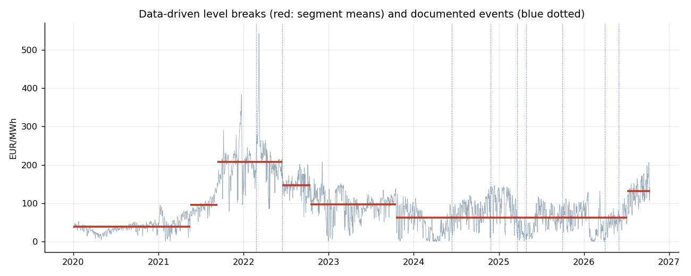
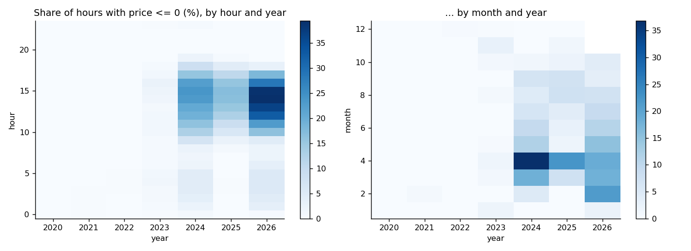
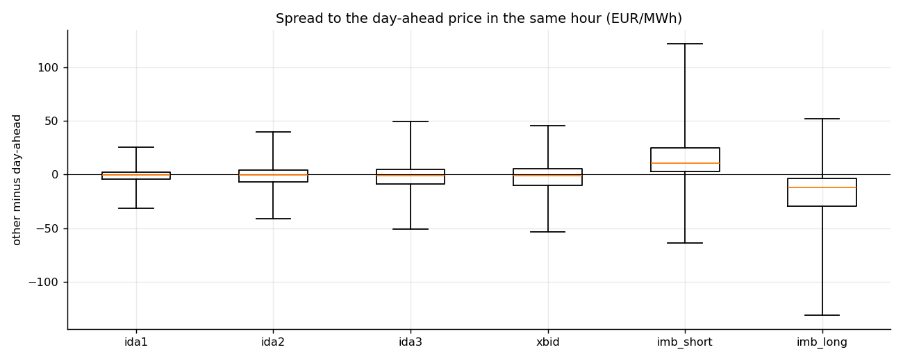

# Phase 4 — Exploratory analysis and market understanding

Status: findings note, 2026-10-11. Part of the programme in `docs/ML_Forecasting_Plan.pdf`.
Code: `common_layer/market_analysis/`, settings `config/market_analysis.yaml`, run with `tools/run_market_analysis.py`
(33 tables, 9 figures; tests in `tests/test_market_analysis.py`). Data: the clean zone, 2020-01-01 to 2026-10-11 for the
day-ahead price (2,476 days, complete), intraday auctions and continuous market from 2024-06-13, aFRR and imbalance from
2019, mFRR from 2024-11-27. All prices are EUR/MWh (aFRR: EUR/MW/h), hourly in market time; the 15-minute day-ahead price
(from 2025-10-01) enters as the mean of its four quarters.

## 1. Result in one paragraph

The day-ahead price is dominated by a slowly moving level (67% of all variance sits in the year-month mean), driven by fuel
and hydrology, not by the documented rule changes. Around that level the **shape of the day** has become the main
structure: solar has pushed midday prices from the daily average (ratio 1.00 in 2020) to under a third of it (0.31 in
2026) and made 8.8% of 2026 hours non-positive. Daily changes of the price are close to uncorrelated while the level is
not stationary, so a model must be given the recent level and be trained on recent years. The intraday prices follow the
day-ahead price closely (it explains 90–98% of their variance), so the spread is the right thing to model. The reserve
prices behave differently again: the aFRR band price is a slowly changing, symmetric series that the day-ahead price
barely explains. Seven modelling consequences follow (section 8).

## 2. Seasonality: the daily shape matters more and more

Ordered variance decomposition of the hourly day-ahead price (`variance_shares_*`): each component takes what the previous
ones left.

| Period | Level (year-month) | Hour of day | Hour × season | Day of week | Residual | Hour of day, share of variance within the month |
|---|---|---|---|---|---|---|
| All years | 67.4% | 5.7% | 2.2% | 1.3% | 23.4% | 17.6% |
| Before the gas crisis (to Feb 2022) | 86.2% | 1.2% | 0.6% | 0.6% | 11.4% | 8.4% |
| Iberian gas cap (Jun 2022–2023) | 35.3% | 12.1% | 4.7% | 3.0% | 44.9% | 18.7% |
| After the cap, before the blackout | 42.9% | 13.7% | 4.6% | 3.6% | 35.2% | 24.0% |
| After the April 2025 blackout | 17.2% | 43.8% | 6.3% | 5.1% | 27.5% | 52.9% |
| 15-minute era (from Oct 2025) | 35.1% | 27.4% | 13.8% | 2.0% | 21.7% | 42.2% |

* The hour of day explained 8% of within-month variance before 2022 and 42–53% since mid-2025.
* The weekend discount grew from −16% (2020) to −28% (2025) of the weekday mean (`weekend_effect`): −5.8 to −20.4 EUR/MWh.
* Calendar month explains only 6% of within-year variance once the year's own mean is removed (`annual_share_within_year`):
  the annual cycle is weak next to year-to-year level shifts and hydrology.

## 3. Dependence and stationarity

| Lag | Hourly price | After removing the year × month × hour × weekend means |
|---|---|---|
| 1 h | 0.979 | 0.954 |
| 24 h | 0.912 | 0.580 |
| 48 h | 0.860 | 0.378 |
| 168 h | 0.817 | −0.014 |

Daily mean: autocorrelation 0.94 at one day, 0.83 at seven, 0.64 at sixty (`acf_*`).

* **Stationarity** (ADF and KPSS together; `stationarity`): the daily mean is non-stationary overall and in four of the six
  periods; its first difference is stationary. Within any single period the level still wanders.
* **Volatility clusters:** the squared residual has autocorrelation 0.94 at lag 1 and 0.52 at lag 24; the ARCH test rejects
  with p < 0.001. Volatility rises with the level, but less than proportionally (elasticity 0.58).
* **Daily changes are close to white noise** (first-order autocorrelation −0.09 to +0.07 in every period), so the effective
  number of independent daily *changes* equals the number of days, while the effective number of independent daily
  *levels* is only 4–11 per period (`ess_by_period`).

## 4. Structural change: what the documented events did and did not do

`event_tests` compares the 60 days before and after each documented date and, because season and weather move prices
around the same calendar dates every year, ranks that shift against the shift at the same date in the other years
(`z_vs_placebo`, six placebo years; windows may contain other events, so this is a yardstick, not a null model).

| Event | Shift (EUR/MWh) | Placebo z | Reading |
|---|---|---|---|
| Iberian gas cap, 2022-06-15 | −39.2 | **−4.3** | clearly beyond normal seasonal movement |
| Settlement period 15 minutes, 2025-03-19 | −65.5 | −1.9 | largest of all years but a very wet spring; a rule about settlement cannot move the day-ahead price |
| Gas crisis start, 2022-02-24 | +48.8 | 2.3 | consistent with a real shift |
| Three intraday auctions, 2024-06-13 | +40.6 | 0.8 | seasonal (May to June) |
| MARI, SDAC 15-minute, blackout, aFRR rules, floor change | | −0.3 to 1.4 | not distinguishable from season |

Data-driven breaks (binary segmentation of the daily mean, `data_driven_breaks`): the six strongest are 2021-05-17,
2021-09-10, 2022-10-15, 2023-10-18, 2026-07-06 and 2022-06-15. **Only the last matches a documented event** (the Iberian
cap); the rest follow fuel and hydrology. The largest structural moves in the price level are not rule changes.

## 5. Distribution, spikes, negative prices and solar cannibalisation

| Year | Mean | Std | Skew | Excess kurtosis | Share of hours ≤ 0 | Midday ÷ average price | Evening − midday (EUR/MWh) |
|---|---|---|---|---|---|---|---|
| 2020 | 34.0 | 11.3 | −0.3 | −0.3 | 0.0% | 1.00 | 5.7 |
| 2021 | 112.0 | 74.7 | 1.1 | 0.7 | 0.0% | 0.95 | 24.2 |
| 2022 | 167.9 | 69.1 | 1.0 | 5.0 | 0.0% | 0.89 | 53.1 |
| 2023 | 88.3 | 39.9 | −0.4 | −0.3 | 0.8% | 0.78 | 45.9 |
| 2024 | 63.5 | 45.6 | 0.1 | −1.1 | 8.2% | 0.65 | 47.2 |
| 2025 | 66.2 | 46.4 | 0.2 | −0.8 | 4.7% | 0.49 | 69.5 |
| 2026 (to 11 Oct) | 77.4 | 69.3 | 0.5 | −0.8 | 11.4% | 0.31 | 95.4 |

* From 2024 the distribution is **bimodal** (a mass near zero at midday, a second mode in the evening: negative excess
  kurtosis), not heavy-tailed. The upper tail is moderate: Hill tail index 5–10 in every period.
* Spikes (trailing robust z-score, information only): 81 upward in 2024, 37 in 2026; downward in 2021 (38).
* Negative prices concentrate at midday hours of spring and summer months and rise every year (`negative_prices` figure).

## 6. Relationships between the markets (hours where both exist; development and later data)

| Series | Correlation with day-ahead (level) | (hour-to-hour change) | Day-ahead explains (R²) | Spread std vs level std |
|---|---|---|---|---|
| IDA1 | 0.985 | 0.919 | 0.969 | 9.5 vs 54.2 |
| IDA2 | 0.968 | 0.832 | 0.936 | 13.9 vs 54.4 |
| IDA3 | 0.958 | 0.807 | 0.918 | 16.8 vs 58.3 |
| Continuous market | 0.949 | 0.731 | 0.900 | 17.3 vs 54.3 |
| Imbalance, shortfall | 0.656 | 0.110 | 0.43 | 77.3 vs 102.5 |
| Imbalance, surplus | 0.846 | 0.243 | 0.72 | 39.0 vs 71.9 |
| mFRR activation price | 0.578 | 0.142 | 0.33 | 56.8 vs 65.1 |
| **aFRR band price (EUR/MW/h)** | **0.057** | −0.205 | 0.003 | not comparable (other unit) |

* The intraday spread is small, positively autocorrelated within the day (0.59–0.73 hour to hour) and barely persistent
  across days (0.02–0.26 at 24 h). It has been **negative on average** (−0.5 to −3.5 EUR/MWh: intraday prices a little
  below day-ahead) and **wider in the 15-minute era** (IDA1 standard deviation 7.3 to 10.8).
* aFRR up and down are the same series (correlation 0.998). Their only strong predictor is their own history
  (daily autocorrelation 0.94).
* mFRR activation prices track the imbalance prices (correlation 0.83 and 0.81) far more than the day-ahead price.
* Imbalance prices have extreme outliers (excess kurtosis 3,400–7,000): single hours far outside any range seen in the
  auctions. They should not be fitted with a squared loss without a transform or clipping.

## 7. Effective sample size and which history is still representative

| Year | Mean | KS distance to the latest 12 months | Similar (< 0.20) |
|---|---|---|---|
| 2020 | 34.0 | 0.57 | no |
| 2021 | 112.0 | 0.25 | no |
| 2022 | 167.9 | 0.56 | no |
| 2023 | 88.3 | 0.23 | no |
| 2024 | 63.5 | 0.14 | yes |
| 2025 | 66.2 | 0.12 | yes |

The two years before 2024 differ in level and in shape (no negative prices, a flat midday); 2024 onward is the same market
in distribution. That is 2.8 years of hourly data and only one year of 15-minute products.

## 8. What this means for the modelling (inputs to Phases 5 to 10)

1. **Give the model the recent level, not just the calendar.** The level is 67% of the variance and non-stationary.
   Features: yesterday's price at the same hour, last week's, rolling 7-day mean and spread; or a de-levelled target.
   (Phase 7 catalogue: `y_lag_*`, `y_roll_*`.)
2. **Trees cannot extrapolate a level they have not seen.** Hold-out error of the same model was 62 EUR/MWh in the rising
   market of 2021, 34 in 2022 and 15 in 2025. Keep the training window to recent, comparable years and use spreads where
   a base price exists.
3. **Train on recent data; the regime split that matters is not a rule change.** Prefer a rolling window (the framework
   uses 730 days) over regime dummies for the documented dates, which mostly do not stand out from season. Years before 2024
   are not representative of today (KS distance 0.23–0.57).
4. **Hour-of-day × month interaction is first order from 2024.** Use hour, calendar month and the shape features; a single
   multiplicative or additive "daily profile" is wrong in the current market.
5. **Model the intraday spread to the day-ahead price,** with the day-ahead result (known at every intraday gate) as a
   feature: it explains 90–98% of the level, and the spread is 3–6 times less variable. (Phase 5.)
6. **Use a transform that allows negatives for heavy-tailed series** (asinh), and evaluate in euros. The day-ahead
   distribution is bimodal from 2024, so a squared loss alone under-weights the typical day and over-weights spike hours;
   treat the loss as a setting. (Phases 5, 8 and 9.)
7. **Plan for few independent observations.** One year of 15-minute data and about ten independent price levels per
   period: keep models small, prefer bagging, and expect differences between models to be modest and to need a significance
   test (Diebold–Mariano, Phase 6) before being believed.

## 9. Limits

* The event test is a yardstick with six placebo years; it cannot prove that an event had no effect, only that its
  shift is not unusual for that time of year.
* The ordered variance decomposition depends on the order of its components.
* Spike flags and ACF figures are computed on the whole history including the 2021–2022 crisis; they describe the market
  as it was, which is the point, but they will move if the crisis years are dropped.
* No fundamentals (load, wind, solar forecasts, gas, carbon) are in the data yet, so the part of the residual that those
  would explain is still in the 22–35% "residual" above (Phase 1 gaps).
* Documented dates marked `to_verify` in `config/market_regimes.yaml` (Iberian exception end, blackout effect) were used as
  given.
