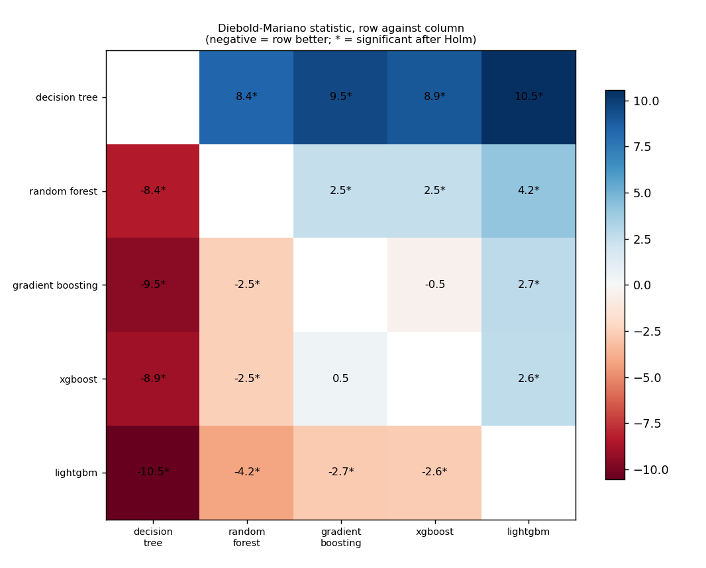
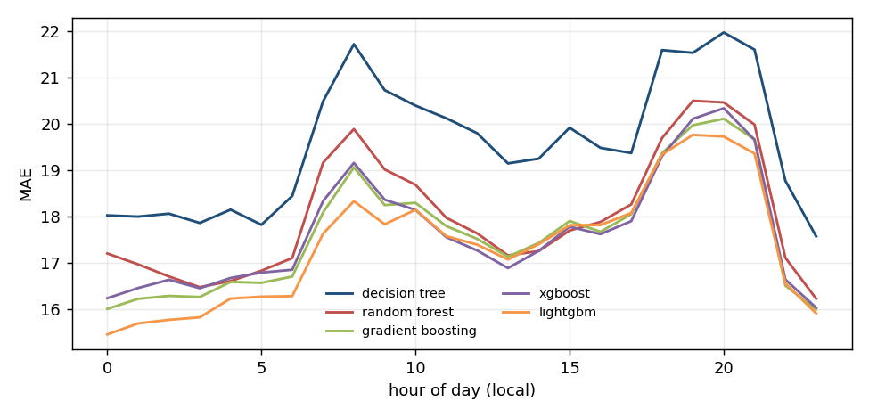
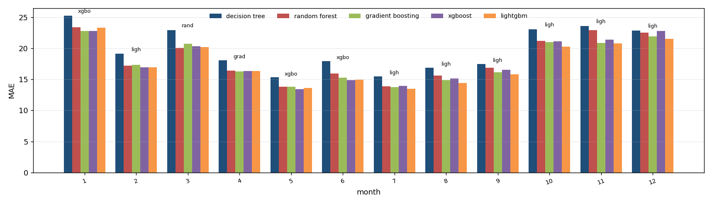
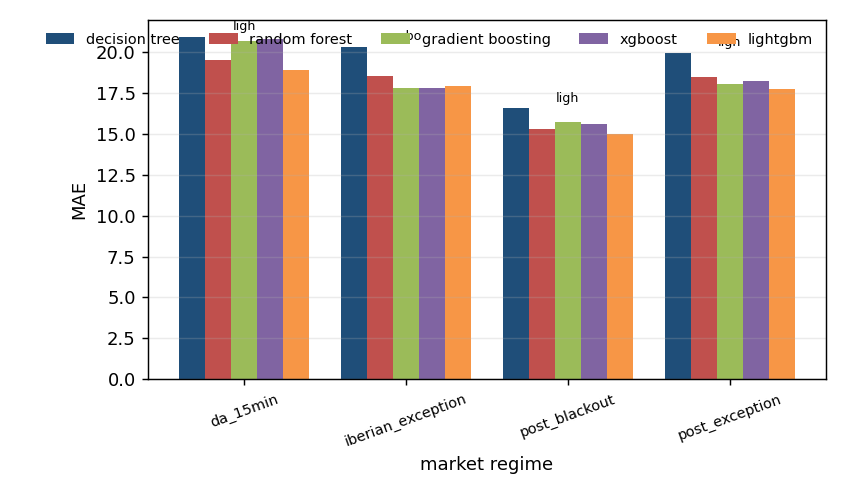

# Algorithm comparison: da_price, development window

Generated by `tools/compare_algorithms.py`; do not edit by hand.

Algorithms: decision_tree, random_forest, gradient_boosting, xgboost, lightgbm. All are scored on the same 24,359 hours. Loss for the tests: absolute error, daily differences, Newey-West variance with 7 lags, Harvey-Leybourne-Newbold correction. A negative statistic means the first algorithm has the smaller loss.

## 1. Scoreboard

`days_best` is the share of delivery days on which the algorithm had the smallest daily MAE.

| model | n | sse | mae | rmse | days_best | mean_daily_rank |
|---|---|---|---|---|---|---|
| lightgbm | 24359 | 14384374.880 | 17.385 | 24.301 | 0.277 | 2.681 |
| gradient_boosting | 24359 | 14699165.249 | 17.642 | 24.565 | 0.179 | 2.798 |
| xgboost | 24359 | 14634439.171 | 17.684 | 24.511 | 0.189 | 2.810 |
| random_forest | 24359 | 14895763.212 | 18.018 | 24.729 | 0.197 | 3.000 |
| decision_tree | 24359 | 18010475.392 | 19.570 | 27.191 | 0.158 | 3.711 |

## 2. Every pair, with the Holm correction

9 of 10 pairs differ significantly at 5% after the Holm correction.

| a | b | n_days | mean_loss_a | mean_loss_b | statistic | p_value | p_holm | better |
|---|---|---|---|---|---|---|---|---|
| decision_tree | random_forest | 1015 | 19.569 | 18.016 | 8.361 | 2.03e-16 | 1.42e-15 | random_forest |
| decision_tree | gradient_boosting | 1015 | 19.569 | 17.640 | 9.541 | 1.01e-20 | 9.12e-20 | gradient_boosting |
| decision_tree | xgboost | 1015 | 19.569 | 17.682 | 8.950 | 1.67e-18 | 1.33e-17 | xgboost |
| decision_tree | lightgbm | 1015 | 19.569 | 17.383 | 10.546 | 9.59e-25 | 9.59e-24 | lightgbm |
| random_forest | gradient_boosting | 1015 | 18.016 | 17.640 | 2.492 | 0.013 | 0.037 | gradient_boosting |
| random_forest | xgboost | 1015 | 18.016 | 17.682 | 2.503 | 0.012 | 0.037 | xgboost |
| random_forest | lightgbm | 1015 | 18.016 | 17.383 | 4.158 | 3.49e-05 | 2.09e-04 | lightgbm |
| gradient_boosting | xgboost | 1015 | 17.640 | 17.682 | -0.476 | 0.634 | 0.634 | gradient_boosting |
| gradient_boosting | lightgbm | 1015 | 17.640 | 17.383 | 2.720 | 0.007 | 0.033 | lightgbm |
| xgboost | lightgbm | 1015 | 17.682 | 17.383 | 2.641 | 0.008 | 0.034 | lightgbm |

## 3. Which algorithms cannot be told apart from the best

Best by mean loss: **lightgbm**. Not distinguishable from it (Holm over the 4 comparisons with the best): **lightgbm**.

| model | mean_loss | best_loss | mean_diff | statistic | p_value | p_holm | distinguishable_from_best |
|---|---|---|---|---|---|---|---|
| decision_tree | 19.569 | 17.383 | 2.185 | 10.546 | 9.59e-25 | 3.83e-24 | True |
| random_forest | 18.016 | 17.383 | 0.633 | 4.158 | 3.49e-05 | 1.05e-04 | True |
| gradient_boosting | 17.640 | 17.383 | 0.257 | 2.720 | 0.007 | 0.013 | True |
| xgboost | 17.682 | 17.383 | 0.299 | 2.641 | 0.008 | 0.013 | True |

## 4. Where each algorithm wins

`lowest_mae` is the algorithm with the smallest average error in the group; `winner` is the one that was best in the most units and `winner_share` the share of units it won (a unit is one day-hour for the hour table, one delivery day otherwise). The two can differ.

### By month of the year

| group | units | decision_tree | random_forest | gradient_boosting | xgboost | lightgbm | lowest_mae | winner | winner_share |
|---|---|---|---|---|---|---|---|---|---|
| 1 | 93 | 25.215 | 23.404 | 22.807 | 22.769 | 23.292 | xgboost | lightgbm | 0.280 |
| 2 | 85 | 19.124 | 17.205 | 17.327 | 16.953 | 16.942 | lightgbm | lightgbm | 0.235 |
| 3 | 93 | 22.933 | 20.093 | 20.758 | 20.328 | 20.197 | random_forest | random_forest | 0.237 |
| 4 | 90 | 18.039 | 16.406 | 16.260 | 16.373 | 16.337 | gradient_boosting | lightgbm | 0.267 |
| 5 | 93 | 15.313 | 13.825 | 13.814 | 13.387 | 13.627 | xgboost | random_forest | 0.237 |
| 6 | 90 | 17.921 | 15.960 | 15.260 | 14.906 | 14.920 | xgboost | lightgbm | 0.311 |
| 7 | 93 | 15.491 | 13.861 | 13.766 | 13.961 | 13.516 | lightgbm | lightgbm | 0.258 |
| 8 | 93 | 16.892 | 15.592 | 14.874 | 15.117 | 14.410 | lightgbm | lightgbm | 0.301 |
| 9 | 90 | 17.473 | 16.891 | 16.145 | 16.565 | 15.781 | lightgbm | lightgbm | 0.278 |
| 10 | 73 | 23.052 | 21.183 | 20.982 | 21.158 | 20.258 | lightgbm | lightgbm | 0.356 |
| 11 | 60 | 23.564 | 22.954 | 20.838 | 21.426 | 20.795 | lightgbm | lightgbm | 0.317 |
| 12 | 62 | 22.862 | 22.538 | 21.949 | 22.795 | 21.538 | lightgbm | lightgbm | 0.290 |

### By market regime

| group | units | decision_tree | random_forest | gradient_boosting | xgboost | lightgbm | lowest_mae | winner | winner_share |
|---|---|---|---|---|---|---|---|---|---|
| da_15min | 11 | 20.941 | 19.499 | 20.702 | 20.774 | 18.911 | lightgbm | random_forest | 0.364 |
| iberian_exception | 365 | 20.306 | 18.563 | 17.799 | 17.778 | 17.921 | xgboost | lightgbm | 0.238 |
| post_blackout | 156 | 16.601 | 15.295 | 15.707 | 15.576 | 14.989 | lightgbm | lightgbm | 0.256 |
| post_exception | 483 | 19.939 | 18.448 | 18.076 | 18.220 | 17.716 | lightgbm | lightgbm | 0.311 |

### By hour of day

| group | units | decision_tree | random_forest | gradient_boosting | xgboost | lightgbm | lowest_mae | winner | winner_share |
|---|---|---|---|---|---|---|---|---|---|
| 0 | 1015 | 18.021 | 17.201 | 16.006 | 16.237 | 15.457 | lightgbm | decision_tree | 0.258 |
| 1 | 1015 | 17.995 | 16.967 | 16.223 | 16.456 | 15.694 | lightgbm | decision_tree | 0.291 |
| 2 | 1012 | 18.058 | 16.706 | 16.286 | 16.635 | 15.771 | lightgbm | decision_tree | 0.277 |
| 3 | 1015 | 17.858 | 16.474 | 16.263 | 16.452 | 15.826 | lightgbm | decision_tree | 0.285 |
| 4 | 1015 | 18.144 | 16.607 | 16.588 | 16.673 | 16.229 | lightgbm | decision_tree | 0.272 |
| 5 | 1015 | 17.819 | 16.829 | 16.568 | 16.789 | 16.269 | lightgbm | decision_tree | 0.300 |
| 6 | 1015 | 18.439 | 17.102 | 16.704 | 16.850 | 16.281 | lightgbm | decision_tree | 0.271 |
| 7 | 1015 | 20.480 | 19.156 | 18.084 | 18.329 | 17.627 | lightgbm | decision_tree | 0.267 |
| 8 | 1015 | 21.710 | 19.882 | 19.056 | 19.151 | 18.327 | lightgbm | lightgbm | 0.228 |
| 9 | 1015 | 20.720 | 19.011 | 18.243 | 18.359 | 17.830 | lightgbm | decision_tree | 0.267 |
| 10 | 1015 | 20.387 | 18.680 | 18.291 | 18.139 | 18.142 | xgboost | decision_tree | 0.272 |
| 11 | 1015 | 20.114 | 17.969 | 17.790 | 17.552 | 17.574 | xgboost | decision_tree | 0.272 |
| 12 | 1015 | 19.792 | 17.634 | 17.515 | 17.266 | 17.391 | xgboost | decision_tree | 0.267 |
| 13 | 1015 | 19.141 | 17.159 | 17.131 | 16.886 | 17.071 | xgboost | decision_tree | 0.272 |
| 14 | 1015 | 19.244 | 17.253 | 17.429 | 17.258 | 17.401 | random_forest | decision_tree | 0.267 |
| 15 | 1015 | 19.911 | 17.695 | 17.900 | 17.778 | 17.809 | random_forest | decision_tree | 0.267 |
| 16 | 1015 | 19.477 | 17.880 | 17.669 | 17.617 | 17.814 | xgboost | decision_tree | 0.263 |
| 17 | 1015 | 19.364 | 18.258 | 18.047 | 17.898 | 18.074 | xgboost | decision_tree | 0.282 |
| 18 | 1015 | 21.583 | 19.689 | 19.364 | 19.299 | 19.334 | xgboost | decision_tree | 0.271 |
| 19 | 1015 | 21.524 | 20.490 | 19.965 | 20.102 | 19.756 | lightgbm | decision_tree | 0.276 |
| 20 | 1015 | 21.963 | 20.455 | 20.103 | 20.329 | 19.720 | lightgbm | decision_tree | 0.255 |
| 21 | 1015 | 21.593 | 19.978 | 19.657 | 19.652 | 19.354 | lightgbm | decision_tree | 0.250 |
| 22 | 1015 | 18.768 | 17.108 | 16.508 | 16.639 | 16.556 | gradient_boosting | decision_tree | 0.244 |
| 23 | 1015 | 17.568 | 16.224 | 15.992 | 16.032 | 15.910 | lightgbm | decision_tree | 0.290 |

Source run: `runtime/analysis/phase9/da_stage2_tpe_v2` (suffix `_tuned`).
