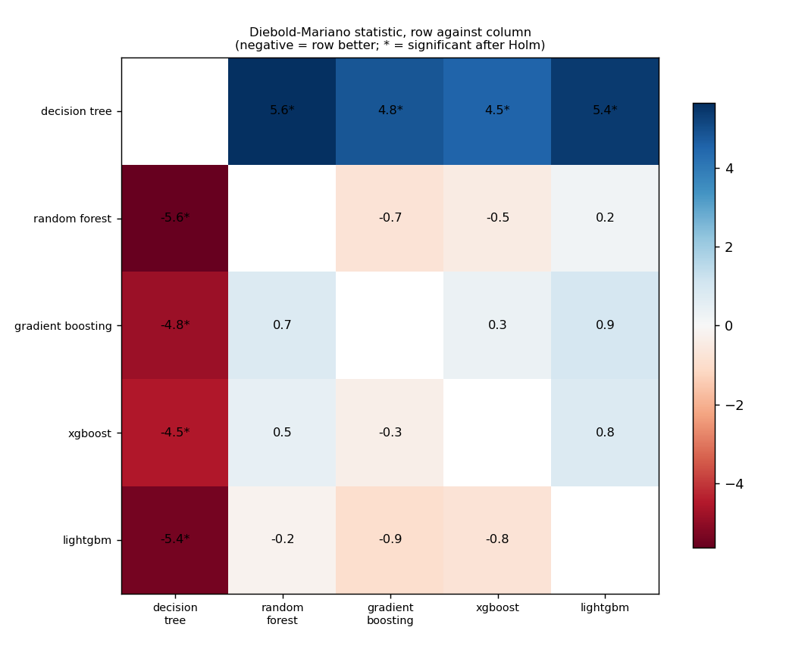
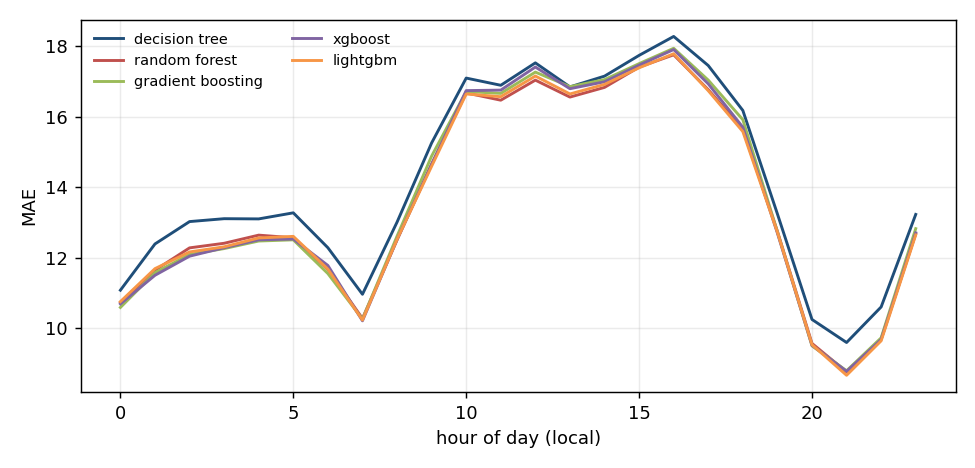
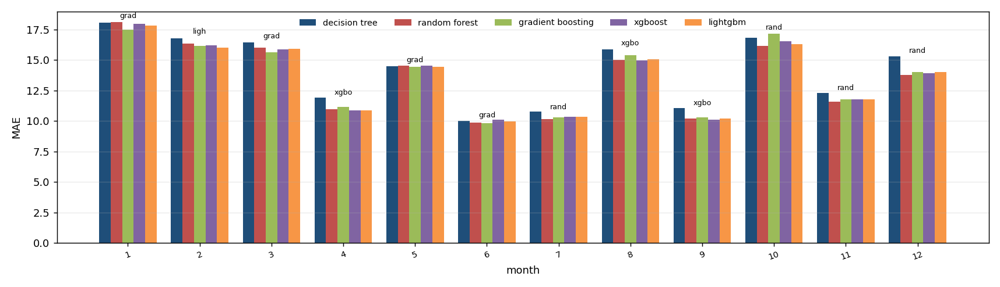
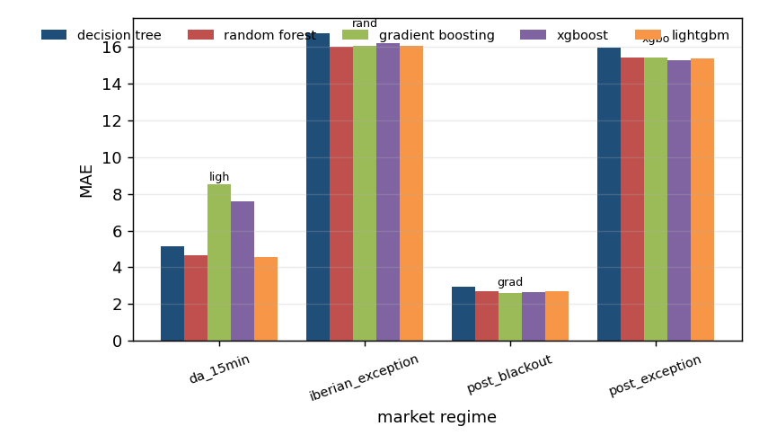

# Algorithm comparison: afrr_cap_price, development window

Generated by `tools/compare_algorithms.py`; do not edit by hand.

Algorithms: decision_tree, random_forest, gradient_boosting, xgboost, lightgbm. All are scored on the same 24,310 hours. Loss for the tests: absolute error, daily differences, Newey-West variance with 7 lags, Harvey-Leybourne-Newbold correction. A negative statistic means the first algorithm has the smaller loss.

## 1. Scoreboard

`days_best` is the share of delivery days on which the algorithm had the smallest daily MAE.

| model | n | sse | mae | rmse | days_best | mean_daily_rank |
|---|---|---|---|---|---|---|
| lightgbm | 24310 | 15366417.495 | 13.569 | 25.142 | 0.195 | 2.893 |
| random_forest | 24310 | 15394442.971 | 13.579 | 25.165 | 0.199 | 2.947 |
| xgboost | 24310 | 15418566.488 | 13.612 | 25.184 | 0.200 | 2.793 |
| gradient_boosting | 24310 | 15442892.039 | 13.636 | 25.204 | 0.183 | 2.876 |
| decision_tree | 24310 | 15752433.174 | 14.144 | 25.455 | 0.222 | 3.491 |

## 2. Every pair, with the Holm correction

4 of 10 pairs differ significantly at 5% after the Holm correction.

| a | b | n_days | mean_loss_a | mean_loss_b | statistic | p_value | p_holm | better |
|---|---|---|---|---|---|---|---|---|
| decision_tree | random_forest | 1014 | 14.138 | 13.575 | 5.637 | 2.25e-08 | 2.25e-07 | random_forest |
| decision_tree | gradient_boosting | 1014 | 14.138 | 13.629 | 4.809 | 1.75e-06 | 1.40e-05 | gradient_boosting |
| decision_tree | xgboost | 1014 | 14.138 | 13.606 | 4.516 | 7.03e-06 | 4.92e-05 | xgboost |
| decision_tree | lightgbm | 1014 | 14.138 | 13.564 | 5.408 | 7.94e-08 | 7.15e-07 | lightgbm |
| random_forest | gradient_boosting | 1014 | 13.575 | 13.629 | -0.749 | 0.454 | 1.000 | random_forest |
| random_forest | xgboost | 1014 | 13.575 | 13.606 | -0.455 | 0.649 | 1.000 | random_forest |
| random_forest | lightgbm | 1014 | 13.575 | 13.564 | 0.203 | 0.839 | 1.000 | lightgbm |
| gradient_boosting | xgboost | 1014 | 13.629 | 13.606 | 0.327 | 0.744 | 1.000 | xgboost |
| gradient_boosting | lightgbm | 1014 | 13.629 | 13.564 | 0.947 | 0.344 | 1.000 | lightgbm |
| xgboost | lightgbm | 1014 | 13.606 | 13.564 | 0.768 | 0.443 | 1.000 | lightgbm |

## 3. Which algorithms cannot be told apart from the best

Best by mean loss: **lightgbm**. Not distinguishable from it (Holm over the 4 comparisons with the best): **lightgbm, random_forest, gradient_boosting, xgboost**.

| model | mean_loss | best_loss | mean_diff | statistic | p_value | p_holm | distinguishable_from_best |
|---|---|---|---|---|---|---|---|
| decision_tree | 14.138 | 13.564 | 0.574 | 5.408 | 7.94e-08 | 3.18e-07 | True |
| random_forest | 13.575 | 13.564 | 0.010 | 0.203 | 0.839 | 1.000 | False |
| gradient_boosting | 13.629 | 13.564 | 0.065 | 0.947 | 0.344 | 1.000 | False |
| xgboost | 13.606 | 13.564 | 0.042 | 0.768 | 0.443 | 1.000 | False |

## 4. Where each algorithm wins

`lowest_mae` is the algorithm with the smallest average error in the group; `winner` is the one that was best in the most units and `winner_share` the share of units it won (a unit is one day-hour for the hour table, one delivery day otherwise). The two can differ.

### By month of the year

| group | units | decision_tree | random_forest | gradient_boosting | xgboost | lightgbm | lowest_mae | winner | winner_share |
|---|---|---|---|---|---|---|---|---|---|
| 1 | 93 | 18.061 | 18.093 | 17.490 | 17.968 | 17.848 | gradient_boosting | decision_tree | 0.269 |
| 2 | 85 | 16.803 | 16.339 | 16.155 | 16.219 | 16.039 | lightgbm | random_forest | 0.247 |
| 3 | 93 | 16.432 | 16.015 | 15.649 | 15.897 | 15.915 | gradient_boosting | gradient_boosting | 0.237 |
| 4 | 89 | 11.915 | 10.959 | 11.163 | 10.865 | 10.886 | xgboost | random_forest | 0.270 |
| 5 | 93 | 14.504 | 14.556 | 14.428 | 14.546 | 14.440 | gradient_boosting | decision_tree | 0.269 |
| 6 | 90 | 10.023 | 9.849 | 9.837 | 10.107 | 9.951 | gradient_boosting | random_forest | 0.233 |
| 7 | 93 | 10.768 | 10.171 | 10.306 | 10.322 | 10.339 | random_forest | random_forest | 0.247 |
| 8 | 93 | 15.887 | 15.002 | 15.405 | 14.970 | 15.055 | xgboost | random_forest | 0.237 |
| 9 | 90 | 11.056 | 10.190 | 10.282 | 10.111 | 10.198 | xgboost | xgboost | 0.300 |
| 10 | 73 | 16.817 | 16.169 | 17.143 | 16.551 | 16.304 | random_forest | decision_tree | 0.274 |
| 11 | 60 | 12.301 | 11.586 | 11.790 | 11.779 | 11.756 | random_forest | gradient_boosting | 0.250 |
| 12 | 62 | 15.300 | 13.783 | 14.021 | 13.903 | 14.006 | random_forest | lightgbm | 0.242 |

### By market regime

| group | units | decision_tree | random_forest | gradient_boosting | xgboost | lightgbm | lowest_mae | winner | winner_share |
|---|---|---|---|---|---|---|---|---|---|
| da_15min | 11 | 5.164 | 4.676 | 8.532 | 7.576 | 4.548 | lightgbm | lightgbm | 0.455 |
| iberian_exception | 365 | 16.769 | 16.040 | 16.047 | 16.199 | 16.067 | random_forest | lightgbm | 0.216 |
| post_blackout | 155 | 2.947 | 2.698 | 2.625 | 2.644 | 2.687 | gradient_boosting | xgboost | 0.252 |
| post_exception | 483 | 15.945 | 15.405 | 15.450 | 15.302 | 15.368 | xgboost | decision_tree | 0.246 |

### By hour of day

| group | units | decision_tree | random_forest | gradient_boosting | xgboost | lightgbm | lowest_mae | winner | winner_share |
|---|---|---|---|---|---|---|---|---|---|
| 0 | 1014 | 11.081 | 10.739 | 10.593 | 10.693 | 10.758 | gradient_boosting | decision_tree | 0.295 |
| 1 | 1014 | 12.391 | 11.647 | 11.579 | 11.504 | 11.692 | xgboost | decision_tree | 0.286 |
| 2 | 1011 | 13.025 | 12.280 | 12.093 | 12.044 | 12.165 | xgboost | decision_tree | 0.280 |
| 3 | 1014 | 13.106 | 12.410 | 12.260 | 12.284 | 12.310 | gradient_boosting | decision_tree | 0.299 |
| 4 | 1014 | 13.100 | 12.641 | 12.474 | 12.508 | 12.561 | gradient_boosting | decision_tree | 0.307 |
| 5 | 1014 | 13.272 | 12.566 | 12.508 | 12.531 | 12.606 | gradient_boosting | decision_tree | 0.318 |
| 6 | 1014 | 12.284 | 11.671 | 11.552 | 11.782 | 11.678 | gradient_boosting | decision_tree | 0.299 |
| 7 | 1013 | 10.966 | 10.282 | 10.263 | 10.214 | 10.234 | xgboost | decision_tree | 0.299 |
| 8 | 1013 | 13.008 | 12.503 | 12.611 | 12.520 | 12.520 | random_forest | decision_tree | 0.314 |
| 9 | 1012 | 15.252 | 14.653 | 14.880 | 14.641 | 14.590 | lightgbm | decision_tree | 0.293 |
| 10 | 1013 | 17.089 | 16.668 | 16.709 | 16.734 | 16.638 | lightgbm | decision_tree | 0.294 |
| 11 | 1013 | 16.885 | 16.462 | 16.655 | 16.748 | 16.562 | random_forest | decision_tree | 0.277 |
| 12 | 1012 | 17.520 | 17.030 | 17.258 | 17.402 | 17.146 | random_forest | decision_tree | 0.281 |
| 13 | 1012 | 16.839 | 16.551 | 16.846 | 16.788 | 16.639 | random_forest | decision_tree | 0.275 |
| 14 | 1012 | 17.144 | 16.825 | 17.045 | 16.984 | 16.909 | random_forest | decision_tree | 0.290 |
| 15 | 1012 | 17.732 | 17.399 | 17.498 | 17.456 | 17.379 | lightgbm | decision_tree | 0.294 |
| 16 | 1012 | 18.268 | 17.747 | 17.933 | 17.897 | 17.779 | random_forest | decision_tree | 0.292 |
| 17 | 1012 | 17.444 | 16.760 | 17.031 | 16.924 | 16.731 | lightgbm | decision_tree | 0.300 |
| 18 | 1012 | 16.172 | 15.639 | 15.911 | 15.698 | 15.574 | lightgbm | decision_tree | 0.301 |
| 19 | 1013 | 13.241 | 12.747 | 12.738 | 12.697 | 12.721 | xgboost | decision_tree | 0.304 |
| 20 | 1013 | 10.252 | 9.574 | 9.505 | 9.520 | 9.538 | gradient_boosting | decision_tree | 0.301 |
| 21 | 1013 | 9.600 | 8.768 | 8.799 | 8.784 | 8.671 | lightgbm | decision_tree | 0.305 |
| 22 | 1013 | 10.607 | 9.698 | 9.733 | 9.685 | 9.648 | lightgbm | decision_tree | 0.301 |
| 23 | 1013 | 13.227 | 12.677 | 12.825 | 12.705 | 12.647 | lightgbm | decision_tree | 0.314 |

Source run: `runtime/analysis/rollout/afrr_cap_price/tuned` (suffix `_tuned`).
