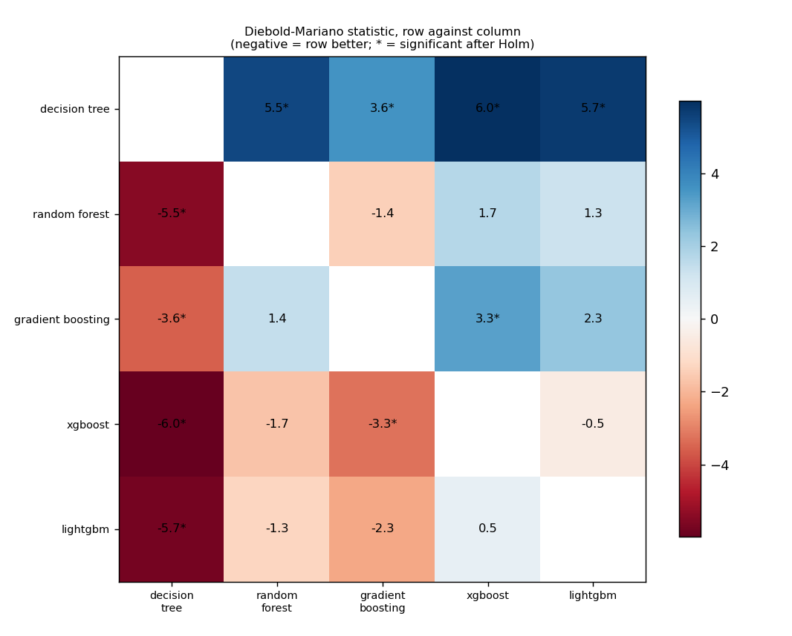
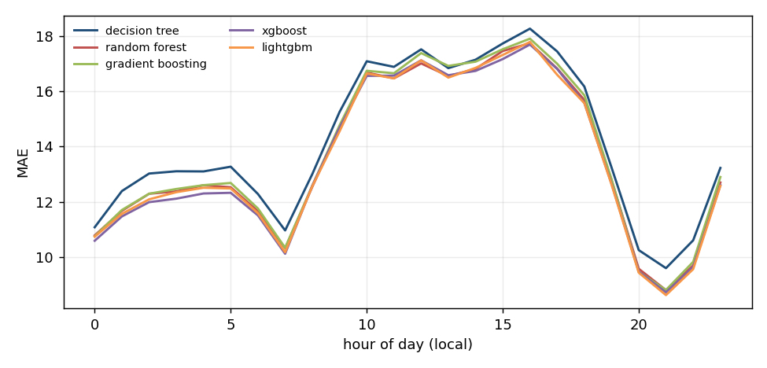
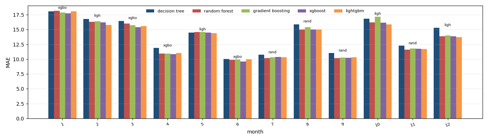
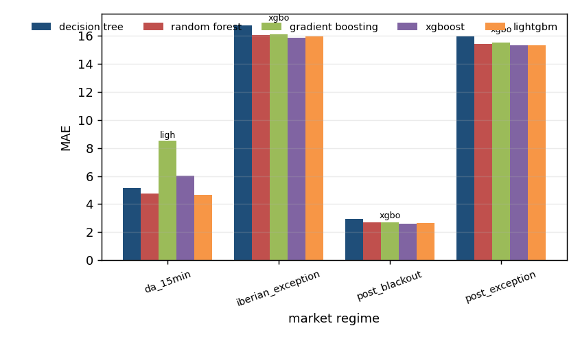

# Algorithm comparison: afrr_dn_price, development window

Generated by `tools/compare_algorithms.py`; do not edit by hand.

Algorithms: decision_tree, random_forest, gradient_boosting, xgboost, lightgbm. All are scored on the same 24,310 hours. Loss for the tests: absolute error, daily differences, Newey-West variance with 7 lags, Harvey-Leybourne-Newbold correction. A negative statistic means the first algorithm has the smaller loss.

## 1. Scoreboard

`days_best` is the share of delivery days on which the algorithm had the smallest daily MAE.

| model | n | sse | mae | rmse | days_best | mean_daily_rank |
|---|---|---|---|---|---|---|
| xgboost | 24310 | 15239740.544 | 13.482 | 25.038 | 0.217 | 2.738 |
| lightgbm | 24310 | 15329924.030 | 13.511 | 25.112 | 0.205 | 2.853 |
| random_forest | 24310 | 15379895.936 | 13.593 | 25.153 | 0.200 | 2.961 |
| gradient_boosting | 24310 | 15661748.980 | 13.700 | 25.382 | 0.165 | 2.937 |
| decision_tree | 24310 | 15752433.174 | 14.144 | 25.455 | 0.213 | 3.512 |

## 2. Every pair, with the Holm correction

5 of 10 pairs differ significantly at 5% after the Holm correction.

| a | b | n_days | mean_loss_a | mean_loss_b | statistic | p_value | p_holm | better |
|---|---|---|---|---|---|---|---|---|
| decision_tree | random_forest | 1014 | 14.138 | 13.589 | 5.461 | 5.94e-08 | 4.76e-07 | random_forest |
| decision_tree | gradient_boosting | 1014 | 14.138 | 13.694 | 3.580 | 3.60e-04 | 0.003 | gradient_boosting |
| decision_tree | xgboost | 1014 | 14.138 | 13.476 | 5.988 | 2.94e-09 | 2.94e-08 | xgboost |
| decision_tree | lightgbm | 1014 | 14.138 | 13.506 | 5.743 | 1.23e-08 | 1.10e-07 | lightgbm |
| random_forest | gradient_boosting | 1014 | 13.589 | 13.694 | -1.438 | 0.151 | 0.452 | random_forest |
| random_forest | xgboost | 1014 | 13.589 | 13.476 | 1.712 | 0.087 | 0.349 | xgboost |
| random_forest | lightgbm | 1014 | 13.589 | 13.506 | 1.295 | 0.196 | 0.452 | lightgbm |
| gradient_boosting | xgboost | 1014 | 13.694 | 13.476 | 3.255 | 0.001 | 0.007 | xgboost |
| gradient_boosting | lightgbm | 1014 | 13.694 | 13.506 | 2.317 | 0.021 | 0.104 | lightgbm |
| xgboost | lightgbm | 1014 | 13.476 | 13.506 | -0.505 | 0.613 | 0.613 | xgboost |

## 3. Which algorithms cannot be told apart from the best

Best by mean loss: **xgboost**. Not distinguishable from it (Holm over the 4 comparisons with the best): **xgboost, random_forest, lightgbm**.

| model | mean_loss | best_loss | mean_diff | statistic | p_value | p_holm | distinguishable_from_best |
|---|---|---|---|---|---|---|---|
| decision_tree | 14.138 | 13.476 | 0.661 | 5.988 | 2.94e-09 | 1.18e-08 | True |
| random_forest | 13.589 | 13.476 | 0.112 | 1.712 | 0.087 | 0.174 | False |
| gradient_boosting | 13.694 | 13.476 | 0.218 | 3.255 | 0.001 | 0.004 | True |
| lightgbm | 13.506 | 13.476 | 0.030 | 0.505 | 0.613 | 0.613 | False |

## 4. Where each algorithm wins

`lowest_mae` is the algorithm with the smallest average error in the group; `winner` is the one that was best in the most units and `winner_share` the share of units it won (a unit is one day-hour for the hour table, one delivery day otherwise). The two can differ.

### By month of the year

| group | units | decision_tree | random_forest | gradient_boosting | xgboost | lightgbm | lowest_mae | winner | winner_share |
|---|---|---|---|---|---|---|---|---|---|
| 1 | 93 | 18.061 | 18.144 | 17.882 | 17.760 | 18.079 | xgboost | decision_tree | 0.312 |
| 2 | 85 | 16.803 | 16.294 | 16.397 | 16.189 | 15.766 | lightgbm | xgboost | 0.247 |
| 3 | 93 | 16.432 | 16.016 | 15.721 | 15.414 | 15.592 | xgboost | xgboost | 0.247 |
| 4 | 89 | 11.915 | 10.946 | 10.963 | 10.868 | 11.061 | xgboost | random_forest | 0.258 |
| 5 | 93 | 14.504 | 14.580 | 14.571 | 14.474 | 14.392 | lightgbm | lightgbm | 0.280 |
| 6 | 90 | 10.023 | 9.875 | 9.932 | 9.626 | 10.002 | xgboost | xgboost | 0.256 |
| 7 | 93 | 10.768 | 10.204 | 10.306 | 10.372 | 10.346 | random_forest | random_forest | 0.237 |
| 8 | 93 | 15.887 | 14.995 | 15.405 | 15.024 | 15.016 | random_forest | xgboost | 0.269 |
| 9 | 90 | 11.056 | 10.189 | 10.282 | 10.221 | 10.327 | random_forest | random_forest | 0.244 |
| 10 | 73 | 16.817 | 16.195 | 17.143 | 16.155 | 15.887 | lightgbm | lightgbm | 0.288 |
| 11 | 60 | 12.301 | 11.606 | 11.790 | 11.741 | 11.720 | random_forest | random_forest | 0.283 |
| 12 | 62 | 15.300 | 13.855 | 13.986 | 13.849 | 13.701 | lightgbm | xgboost | 0.306 |

### By market regime

| group | units | decision_tree | random_forest | gradient_boosting | xgboost | lightgbm | lowest_mae | winner | winner_share |
|---|---|---|---|---|---|---|---|---|---|
| da_15min | 11 | 5.164 | 4.764 | 8.532 | 6.026 | 4.678 | lightgbm | xgboost | 0.273 |
| iberian_exception | 365 | 16.769 | 16.043 | 16.115 | 15.861 | 15.958 | xgboost | lightgbm | 0.252 |
| post_blackout | 155 | 2.947 | 2.721 | 2.705 | 2.594 | 2.649 | xgboost | xgboost | 0.245 |
| post_exception | 483 | 15.945 | 15.422 | 15.509 | 15.336 | 15.338 | xgboost | decision_tree | 0.234 |

### By hour of day

| group | units | decision_tree | random_forest | gradient_boosting | xgboost | lightgbm | lowest_mae | winner | winner_share |
|---|---|---|---|---|---|---|---|---|---|
| 0 | 1014 | 11.081 | 10.788 | 10.753 | 10.592 | 10.739 | xgboost | decision_tree | 0.289 |
| 1 | 1014 | 12.391 | 11.675 | 11.706 | 11.473 | 11.567 | xgboost | decision_tree | 0.275 |
| 2 | 1011 | 13.025 | 12.293 | 12.295 | 11.989 | 12.091 | xgboost | decision_tree | 0.280 |
| 3 | 1014 | 13.106 | 12.378 | 12.465 | 12.115 | 12.349 | xgboost | decision_tree | 0.297 |
| 4 | 1014 | 13.100 | 12.603 | 12.604 | 12.303 | 12.510 | xgboost | decision_tree | 0.301 |
| 5 | 1014 | 13.272 | 12.528 | 12.683 | 12.327 | 12.484 | xgboost | decision_tree | 0.305 |
| 6 | 1014 | 12.284 | 11.661 | 11.760 | 11.510 | 11.587 | xgboost | decision_tree | 0.294 |
| 7 | 1013 | 10.966 | 10.323 | 10.337 | 10.121 | 10.177 | xgboost | decision_tree | 0.285 |
| 8 | 1013 | 13.008 | 12.546 | 12.589 | 12.591 | 12.569 | random_forest | decision_tree | 0.302 |
| 9 | 1012 | 15.252 | 14.685 | 14.768 | 14.682 | 14.550 | lightgbm | decision_tree | 0.292 |
| 10 | 1013 | 17.089 | 16.678 | 16.743 | 16.559 | 16.645 | xgboost | decision_tree | 0.285 |
| 11 | 1013 | 16.885 | 16.469 | 16.654 | 16.568 | 16.469 | random_forest | decision_tree | 0.276 |
| 12 | 1012 | 17.520 | 17.010 | 17.384 | 17.122 | 17.121 | random_forest | decision_tree | 0.288 |
| 13 | 1012 | 16.839 | 16.552 | 16.920 | 16.583 | 16.497 | lightgbm | decision_tree | 0.282 |
| 14 | 1012 | 17.144 | 16.811 | 17.073 | 16.739 | 16.848 | xgboost | decision_tree | 0.292 |
| 15 | 1012 | 17.732 | 17.460 | 17.524 | 17.168 | 17.317 | xgboost | decision_tree | 0.296 |
| 16 | 1012 | 18.268 | 17.739 | 17.905 | 17.693 | 17.787 | xgboost | decision_tree | 0.292 |
| 17 | 1012 | 17.444 | 16.824 | 16.998 | 16.809 | 16.599 | lightgbm | decision_tree | 0.301 |
| 18 | 1012 | 16.172 | 15.686 | 15.856 | 15.578 | 15.575 | lightgbm | decision_tree | 0.288 |
| 19 | 1013 | 13.241 | 12.781 | 12.819 | 12.655 | 12.623 | lightgbm | decision_tree | 0.288 |
| 20 | 1013 | 10.252 | 9.577 | 9.463 | 9.472 | 9.436 | lightgbm | decision_tree | 0.286 |
| 21 | 1013 | 9.600 | 8.805 | 8.810 | 8.724 | 8.625 | lightgbm | decision_tree | 0.291 |
| 22 | 1013 | 10.607 | 9.696 | 9.828 | 9.646 | 9.564 | lightgbm | decision_tree | 0.285 |
| 23 | 1013 | 13.227 | 12.701 | 12.899 | 12.599 | 12.579 | lightgbm | decision_tree | 0.308 |

Source run: `runtime/analysis/rollout/afrr_dn_price/tuned` (suffix `_tuned`).
