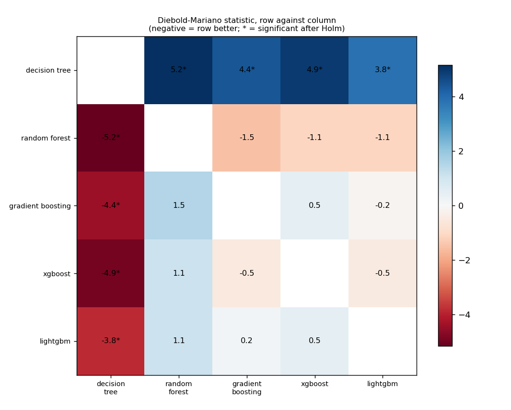
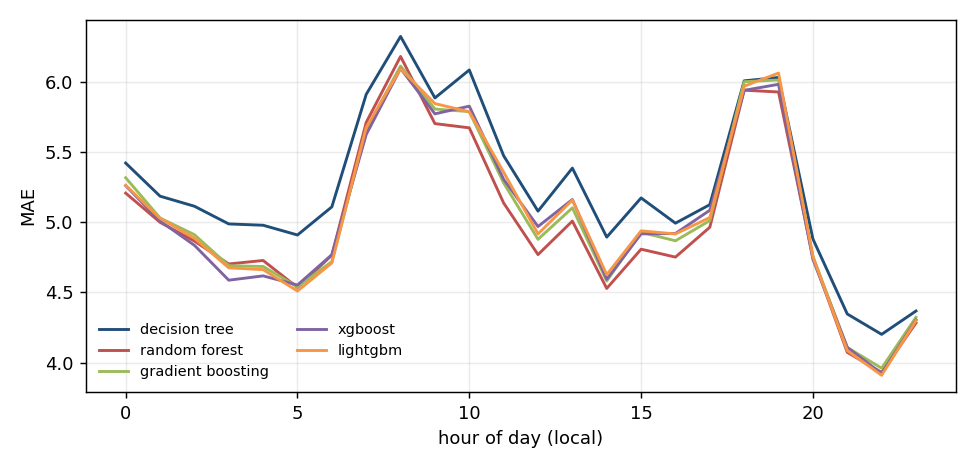
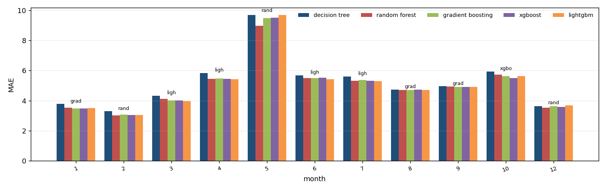
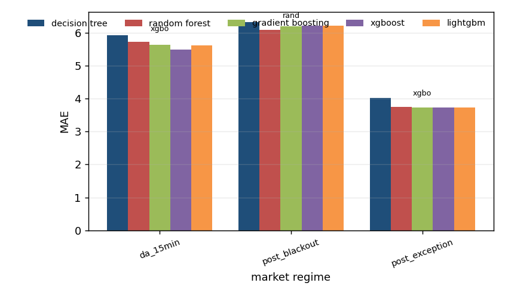

# Algorithm comparison: ida1_price, development window

Generated by `tools/compare_algorithms.py`; do not edit by hand.

Algorithms: decision_tree, random_forest, gradient_boosting, xgboost, lightgbm. All are scored on the same 7,031 hours. Loss for the tests: absolute error, daily differences, Newey-West variance with 7 lags, Harvey-Leybourne-Newbold correction. A negative statistic means the first algorithm has the smaller loss.

## 1. Scoreboard

`days_best` is the share of delivery days on which the algorithm had the smallest daily MAE.

| model | n | sse | mae | rmse | days_best | mean_daily_rank |
|---|---|---|---|---|---|---|
| random_forest | 7031 | 460428.233 | 4.998 | 8.092 | 0.294 | 2.679 |
| xgboost | 7031 | 476455.931 | 5.038 | 8.232 | 0.143 | 2.877 |
| gradient_boosting | 7031 | 473955.305 | 5.045 | 8.210 | 0.154 | 2.949 |
| lightgbm | 7031 | 479178.322 | 5.049 | 8.255 | 0.205 | 2.795 |
| decision_tree | 7031 | 495617.591 | 5.245 | 8.396 | 0.205 | 3.700 |

## 2. Every pair, with the Holm correction

4 of 10 pairs differ significantly at 5% after the Holm correction.

| a | b | n_days | mean_loss_a | mean_loss_b | statistic | p_value | p_holm | better |
|---|---|---|---|---|---|---|---|---|
| decision_tree | random_forest | 293 | 5.245 | 4.998 | 5.161 | 4.55e-07 | 4.55e-06 | random_forest |
| decision_tree | gradient_boosting | 293 | 5.245 | 5.045 | 4.412 | 1.45e-05 | 1.16e-04 | gradient_boosting |
| decision_tree | xgboost | 293 | 5.245 | 5.037 | 4.925 | 1.42e-06 | 1.27e-05 | xgboost |
| decision_tree | lightgbm | 293 | 5.245 | 5.049 | 3.847 | 1.47e-04 | 0.001 | lightgbm |
| random_forest | gradient_boosting | 293 | 4.998 | 5.045 | -1.507 | 0.133 | 0.798 | random_forest |
| random_forest | xgboost | 293 | 4.998 | 5.037 | -1.121 | 0.263 | 1.000 | random_forest |
| random_forest | lightgbm | 293 | 4.998 | 5.049 | -1.113 | 0.266 | 1.000 | random_forest |
| gradient_boosting | xgboost | 293 | 5.045 | 5.037 | 0.501 | 0.617 | 1.000 | xgboost |
| gradient_boosting | lightgbm | 293 | 5.045 | 5.049 | -0.158 | 0.875 | 1.000 | gradient_boosting |
| xgboost | lightgbm | 293 | 5.037 | 5.049 | -0.470 | 0.638 | 1.000 | xgboost |

## 3. Which algorithms cannot be told apart from the best

Best by mean loss: **random_forest**. Not distinguishable from it (Holm over the 4 comparisons with the best): **random_forest, gradient_boosting, xgboost, lightgbm**.

| model | mean_loss | best_loss | mean_diff | statistic | p_value | p_holm | distinguishable_from_best |
|---|---|---|---|---|---|---|---|
| decision_tree | 5.245 | 4.998 | 0.247 | 5.161 | 4.55e-07 | 1.82e-06 | True |
| gradient_boosting | 5.045 | 4.998 | 0.047 | 1.507 | 0.133 | 0.399 | False |
| xgboost | 5.037 | 4.998 | 0.040 | 1.121 | 0.263 | 0.526 | False |
| lightgbm | 5.049 | 4.998 | 0.051 | 1.113 | 0.266 | 0.526 | False |

## 4. Where each algorithm wins

`lowest_mae` is the algorithm with the smallest average error in the group; `winner` is the one that was best in the most units and `winner_share` the share of units it won (a unit is one day-hour for the hour table, one delivery day otherwise). The two can differ.

### By month of the year

| group | units | decision_tree | random_forest | gradient_boosting | xgboost | lightgbm | lowest_mae | winner | winner_share |
|---|---|---|---|---|---|---|---|---|---|
| 1 | 31 | 3.795 | 3.525 | 3.465 | 3.477 | 3.501 | gradient_boosting | random_forest | 0.290 |
| 2 | 27 | 3.306 | 3.029 | 3.057 | 3.049 | 3.054 | random_forest | lightgbm | 0.259 |
| 3 | 31 | 4.330 | 4.106 | 4.006 | 4.017 | 3.972 | lightgbm | random_forest | 0.290 |
| 4 | 28 | 5.818 | 5.437 | 5.471 | 5.437 | 5.421 | lightgbm | random_forest | 0.357 |
| 5 | 31 | 9.690 | 8.982 | 9.493 | 9.524 | 9.681 | random_forest | random_forest | 0.516 |
| 6 | 29 | 5.669 | 5.505 | 5.507 | 5.518 | 5.426 | lightgbm | gradient_boosting | 0.276 |
| 7 | 26 | 5.595 | 5.331 | 5.379 | 5.317 | 5.305 | lightgbm | lightgbm | 0.346 |
| 8 | 30 | 4.728 | 4.707 | 4.701 | 4.725 | 4.703 | gradient_boosting | decision_tree | 0.400 |
| 9 | 30 | 4.949 | 4.945 | 4.896 | 4.911 | 4.901 | gradient_boosting | decision_tree | 0.367 |
| 10 | 10 | 5.926 | 5.723 | 5.629 | 5.485 | 5.619 | xgboost | xgboost | 0.600 |
| 12 | 20 | 3.642 | 3.516 | 3.637 | 3.583 | 3.678 | random_forest | random_forest | 0.450 |

### By market regime

| group | units | decision_tree | random_forest | gradient_boosting | xgboost | lightgbm | lowest_mae | winner | winner_share |
|---|---|---|---|---|---|---|---|---|---|
| da_15min | 10 | 5.926 | 5.723 | 5.629 | 5.485 | 5.619 | xgboost | xgboost | 0.600 |
| post_blackout | 148 | 6.322 | 6.094 | 6.199 | 6.204 | 6.210 | random_forest | decision_tree | 0.291 |
| post_exception | 135 | 4.013 | 3.742 | 3.736 | 3.725 | 3.733 | xgboost | random_forest | 0.311 |

### By hour of day

| group | units | decision_tree | random_forest | gradient_boosting | xgboost | lightgbm | lowest_mae | winner | winner_share |
|---|---|---|---|---|---|---|---|---|---|
| 0 | 293 | 5.422 | 5.208 | 5.317 | 5.261 | 5.263 | random_forest | decision_tree | 0.290 |
| 1 | 293 | 5.186 | 5.000 | 5.030 | 5.009 | 5.028 | random_forest | decision_tree | 0.297 |
| 2 | 292 | 5.114 | 4.866 | 4.912 | 4.836 | 4.887 | xgboost | decision_tree | 0.257 |
| 3 | 293 | 4.988 | 4.703 | 4.691 | 4.587 | 4.675 | xgboost | decision_tree | 0.259 |
| 4 | 293 | 4.979 | 4.728 | 4.685 | 4.618 | 4.663 | xgboost | random_forest | 0.229 |
| 5 | 293 | 4.909 | 4.536 | 4.541 | 4.553 | 4.510 | lightgbm | lightgbm | 0.249 |
| 6 | 293 | 5.110 | 4.765 | 4.720 | 4.769 | 4.710 | lightgbm | random_forest | 0.242 |
| 7 | 293 | 5.911 | 5.711 | 5.661 | 5.625 | 5.676 | xgboost | decision_tree | 0.290 |
| 8 | 293 | 6.324 | 6.181 | 6.113 | 6.095 | 6.093 | lightgbm | decision_tree | 0.321 |
| 9 | 293 | 5.886 | 5.703 | 5.807 | 5.773 | 5.846 | random_forest | decision_tree | 0.338 |
| 10 | 293 | 6.085 | 5.673 | 5.788 | 5.827 | 5.787 | random_forest | decision_tree | 0.287 |
| 11 | 293 | 5.474 | 5.137 | 5.280 | 5.306 | 5.357 | random_forest | decision_tree | 0.297 |
| 12 | 293 | 5.079 | 4.770 | 4.879 | 4.970 | 4.917 | random_forest | random_forest | 0.304 |
| 13 | 293 | 5.386 | 5.009 | 5.103 | 5.162 | 5.158 | random_forest | random_forest | 0.287 |
| 14 | 293 | 4.894 | 4.529 | 4.582 | 4.594 | 4.627 | random_forest | random_forest | 0.266 |
| 15 | 293 | 5.173 | 4.808 | 4.928 | 4.918 | 4.939 | random_forest | random_forest | 0.287 |
| 16 | 293 | 4.994 | 4.752 | 4.868 | 4.920 | 4.917 | random_forest | decision_tree | 0.294 |
| 17 | 293 | 5.126 | 4.965 | 5.012 | 5.086 | 5.034 | random_forest | decision_tree | 0.334 |
| 18 | 293 | 6.008 | 5.941 | 6.002 | 5.940 | 5.970 | xgboost | decision_tree | 0.358 |
| 19 | 293 | 6.032 | 5.928 | 6.014 | 5.983 | 6.063 | random_forest | decision_tree | 0.345 |
| 20 | 293 | 4.881 | 4.751 | 4.756 | 4.736 | 4.755 | xgboost | decision_tree | 0.290 |
| 21 | 293 | 4.347 | 4.074 | 4.108 | 4.109 | 4.086 | random_forest | random_forest | 0.246 |
| 22 | 293 | 4.202 | 3.930 | 3.961 | 3.921 | 3.910 | lightgbm | lightgbm | 0.235 |
| 23 | 293 | 4.368 | 4.283 | 4.323 | 4.305 | 4.299 | random_forest | decision_tree | 0.263 |

Source run: `runtime/analysis/rollout/ida1_price/tuned` (suffix `_tuned`).
