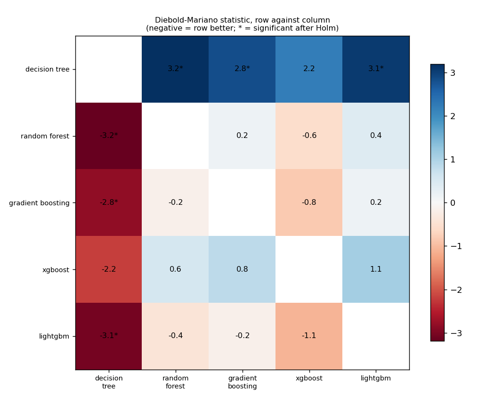
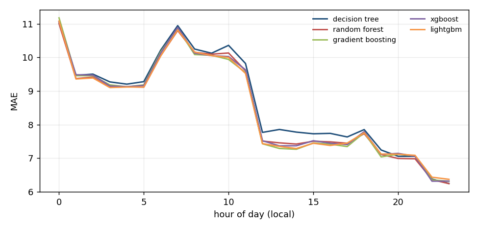
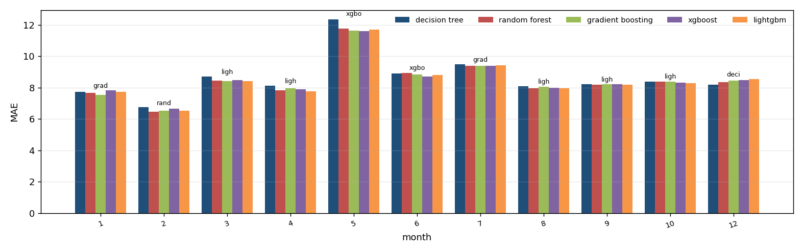
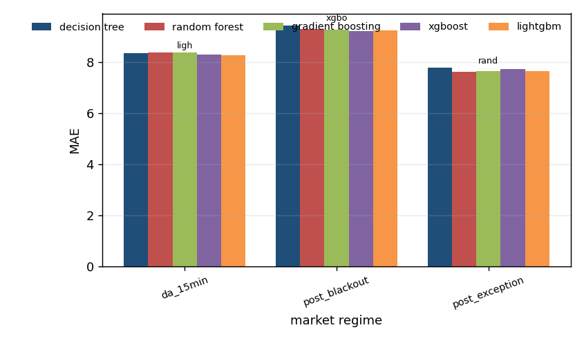

# Algorithm comparison: ida2_price, development window

Generated by `tools/compare_algorithms.py`; do not edit by hand.

Algorithms: decision_tree, random_forest, gradient_boosting, xgboost, lightgbm. All are scored on the same 7,151 hours. Loss for the tests: absolute error, daily differences, Newey-West variance with 7 lags, Harvey-Leybourne-Newbold correction. A negative statistic means the first algorithm has the smaller loss.

## 1. Scoreboard

`days_best` is the share of delivery days on which the algorithm had the smallest daily MAE.

| model | n | sse | mae | rmse | days_best | mean_daily_rank |
|---|---|---|---|---|---|---|
| lightgbm | 7151 | 1156078.617 | 8.499 | 12.715 | 0.178 | 2.909 |
| gradient_boosting | 7151 | 1158316.107 | 8.503 | 12.727 | 0.195 | 2.903 |
| random_forest | 7151 | 1158314.682 | 8.508 | 12.727 | 0.198 | 2.943 |
| xgboost | 7151 | 1154494.381 | 8.527 | 12.706 | 0.181 | 2.926 |
| decision_tree | 7151 | 1187372.030 | 8.658 | 12.886 | 0.248 | 3.319 |

## 2. Every pair, with the Holm correction

3 of 10 pairs differ significantly at 5% after the Holm correction.

| a | b | n_days | mean_loss_a | mean_loss_b | statistic | p_value | p_holm | better |
|---|---|---|---|---|---|---|---|---|
| decision_tree | random_forest | 298 | 8.658 | 8.507 | 3.191 | 0.002 | 0.016 | random_forest |
| decision_tree | gradient_boosting | 298 | 8.658 | 8.503 | 2.817 | 0.005 | 0.041 | gradient_boosting |
| decision_tree | xgboost | 298 | 8.658 | 8.527 | 2.194 | 0.029 | 0.203 | xgboost |
| decision_tree | lightgbm | 298 | 8.658 | 8.498 | 3.053 | 0.002 | 0.022 | lightgbm |
| random_forest | gradient_boosting | 298 | 8.507 | 8.503 | 0.165 | 0.869 | 1.000 | gradient_boosting |
| random_forest | xgboost | 298 | 8.507 | 8.527 | -0.564 | 0.573 | 1.000 | random_forest |
| random_forest | lightgbm | 298 | 8.507 | 8.498 | 0.406 | 0.685 | 1.000 | lightgbm |
| gradient_boosting | xgboost | 298 | 8.503 | 8.527 | -0.837 | 0.403 | 1.000 | gradient_boosting |
| gradient_boosting | lightgbm | 298 | 8.503 | 8.498 | 0.158 | 0.875 | 1.000 | lightgbm |
| xgboost | lightgbm | 298 | 8.527 | 8.498 | 1.095 | 0.275 | 1.000 | lightgbm |

## 3. Which algorithms cannot be told apart from the best

Best by mean loss: **lightgbm**. Not distinguishable from it (Holm over the 4 comparisons with the best): **lightgbm, random_forest, gradient_boosting, xgboost**.

| model | mean_loss | best_loss | mean_diff | statistic | p_value | p_holm | distinguishable_from_best |
|---|---|---|---|---|---|---|---|
| decision_tree | 8.658 | 8.498 | 0.159 | 3.053 | 0.002 | 0.010 | True |
| random_forest | 8.507 | 8.498 | 0.009 | 0.406 | 0.685 | 1.000 | False |
| gradient_boosting | 8.503 | 8.498 | 0.004 | 0.158 | 0.875 | 1.000 | False |
| xgboost | 8.527 | 8.498 | 0.028 | 1.095 | 0.275 | 0.824 | False |

## 4. Where each algorithm wins

`lowest_mae` is the algorithm with the smallest average error in the group; `winner` is the one that was best in the most units and `winner_share` the share of units it won (a unit is one day-hour for the hour table, one delivery day otherwise). The two can differ.

### By month of the year

| group | units | decision_tree | random_forest | gradient_boosting | xgboost | lightgbm | lowest_mae | winner | winner_share |
|---|---|---|---|---|---|---|---|---|---|
| 1 | 31 | 7.733 | 7.671 | 7.536 | 7.839 | 7.731 | gradient_boosting | decision_tree | 0.387 |
| 2 | 27 | 6.753 | 6.449 | 6.526 | 6.650 | 6.542 | random_forest | random_forest | 0.370 |
| 3 | 31 | 8.693 | 8.451 | 8.410 | 8.477 | 8.403 | lightgbm | decision_tree | 0.258 |
| 4 | 29 | 8.113 | 7.833 | 7.972 | 7.906 | 7.762 | lightgbm | random_forest | 0.276 |
| 5 | 29 | 12.327 | 11.749 | 11.627 | 11.605 | 11.696 | xgboost | gradient_boosting | 0.345 |
| 6 | 30 | 8.894 | 8.939 | 8.825 | 8.712 | 8.792 | xgboost | xgboost | 0.333 |
| 7 | 30 | 9.469 | 9.396 | 9.381 | 9.389 | 9.422 | gradient_boosting | decision_tree | 0.267 |
| 8 | 31 | 8.074 | 7.973 | 8.048 | 7.995 | 7.954 | lightgbm | lightgbm | 0.323 |
| 9 | 30 | 8.227 | 8.174 | 8.210 | 8.211 | 8.168 | lightgbm | random_forest | 0.333 |
| 10 | 11 | 8.370 | 8.391 | 8.386 | 8.317 | 8.291 | lightgbm | lightgbm | 0.273 |
| 12 | 19 | 8.191 | 8.353 | 8.454 | 8.482 | 8.536 | decision_tree | decision_tree | 0.368 |

### By market regime

| group | units | decision_tree | random_forest | gradient_boosting | xgboost | lightgbm | lowest_mae | winner | winner_share |
|---|---|---|---|---|---|---|---|---|---|
| da_15min | 11 | 8.370 | 8.391 | 8.386 | 8.317 | 8.291 | lightgbm | lightgbm | 0.273 |
| post_blackout | 152 | 9.444 | 9.297 | 9.271 | 9.235 | 9.258 | xgboost | decision_tree | 0.250 |
| post_exception | 135 | 7.796 | 7.628 | 7.646 | 7.747 | 7.660 | random_forest | decision_tree | 0.252 |

### By hour of day

| group | units | decision_tree | random_forest | gradient_boosting | xgboost | lightgbm | lowest_mae | winner | winner_share |
|---|---|---|---|---|---|---|---|---|---|
| 0 | 298 | 11.054 | 11.003 | 11.177 | 11.057 | 11.082 | random_forest | decision_tree | 0.326 |
| 1 | 298 | 9.465 | 9.368 | 9.454 | 9.482 | 9.357 | lightgbm | decision_tree | 0.289 |
| 2 | 297 | 9.501 | 9.412 | 9.455 | 9.473 | 9.387 | lightgbm | decision_tree | 0.256 |
| 3 | 298 | 9.270 | 9.111 | 9.181 | 9.148 | 9.102 | lightgbm | decision_tree | 0.272 |
| 4 | 298 | 9.203 | 9.126 | 9.124 | 9.128 | 9.117 | lightgbm | decision_tree | 0.315 |
| 5 | 298 | 9.277 | 9.114 | 9.181 | 9.162 | 9.117 | random_forest | decision_tree | 0.279 |
| 6 | 298 | 10.217 | 10.052 | 10.169 | 10.130 | 10.046 | lightgbm | decision_tree | 0.285 |
| 7 | 298 | 10.945 | 10.798 | 10.861 | 10.893 | 10.816 | random_forest | decision_tree | 0.289 |
| 8 | 298 | 10.247 | 10.151 | 10.083 | 10.125 | 10.157 | gradient_boosting | decision_tree | 0.315 |
| 9 | 298 | 10.124 | 10.094 | 10.063 | 10.050 | 10.052 | xgboost | decision_tree | 0.322 |
| 10 | 298 | 10.358 | 10.131 | 9.939 | 10.024 | 9.998 | gradient_boosting | decision_tree | 0.262 |
| 11 | 298 | 9.818 | 9.602 | 9.549 | 9.631 | 9.522 | lightgbm | decision_tree | 0.292 |
| 12 | 298 | 7.767 | 7.509 | 7.429 | 7.519 | 7.433 | gradient_boosting | decision_tree | 0.279 |
| 13 | 298 | 7.854 | 7.455 | 7.288 | 7.366 | 7.350 | gradient_boosting | decision_tree | 0.272 |
| 14 | 298 | 7.776 | 7.420 | 7.265 | 7.369 | 7.287 | gradient_boosting | decision_tree | 0.282 |
| 15 | 298 | 7.726 | 7.504 | 7.451 | 7.519 | 7.443 | lightgbm | decision_tree | 0.305 |
| 16 | 298 | 7.738 | 7.485 | 7.417 | 7.445 | 7.378 | lightgbm | decision_tree | 0.282 |
| 17 | 298 | 7.632 | 7.445 | 7.345 | 7.403 | 7.448 | gradient_boosting | decision_tree | 0.248 |
| 18 | 298 | 7.851 | 7.730 | 7.761 | 7.789 | 7.757 | random_forest | decision_tree | 0.285 |
| 19 | 298 | 7.243 | 7.109 | 7.037 | 7.110 | 7.122 | gradient_boosting | decision_tree | 0.285 |
| 20 | 298 | 7.056 | 6.991 | 7.117 | 7.143 | 7.119 | random_forest | decision_tree | 0.319 |
| 21 | 298 | 7.054 | 6.982 | 7.066 | 7.057 | 7.084 | random_forest | decision_tree | 0.326 |
| 22 | 298 | 6.378 | 6.362 | 6.352 | 6.315 | 6.433 | xgboost | decision_tree | 0.292 |
| 23 | 298 | 6.247 | 6.242 | 6.313 | 6.318 | 6.371 | random_forest | decision_tree | 0.362 |

Source run: `runtime/analysis/rollout/ida2_price/tuned` (suffix `_tuned`).
