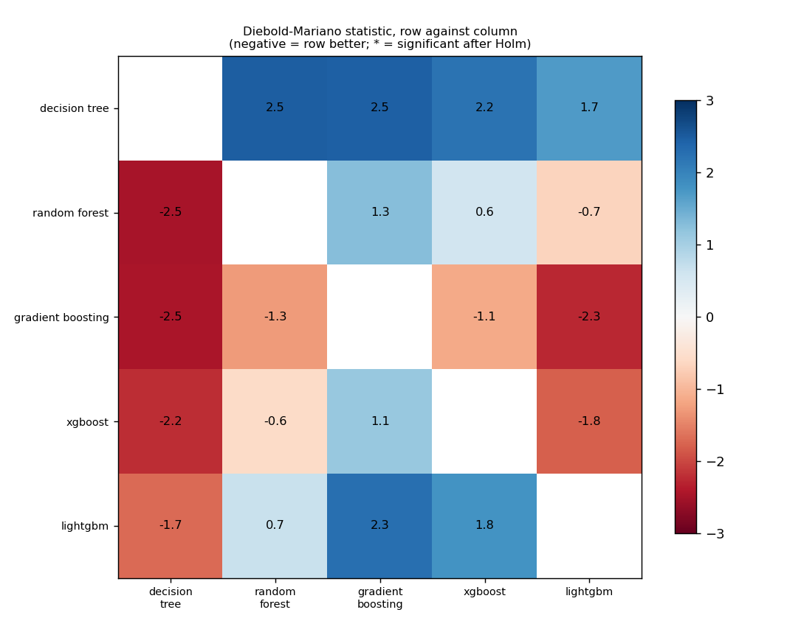
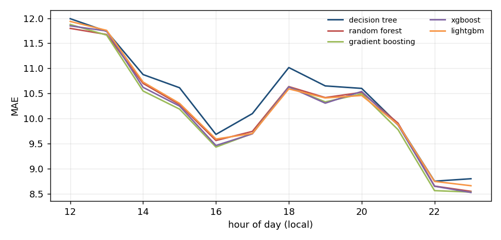
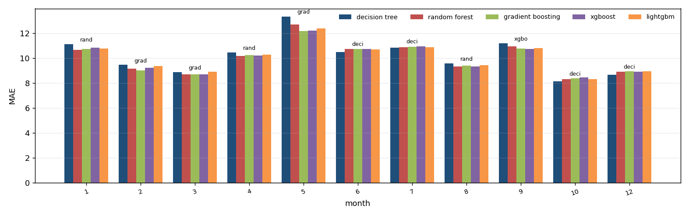
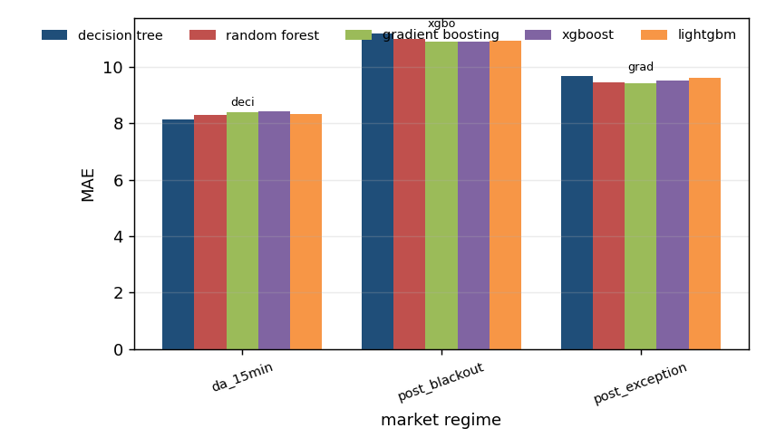

# Algorithm comparison: ida3_price, development window

Generated by `tools/compare_algorithms.py`; do not edit by hand.

Algorithms: decision_tree, random_forest, gradient_boosting, xgboost, lightgbm. All are scored on the same 3,600 hours. Loss for the tests: absolute error, daily differences, Newey-West variance with 7 lags, Harvey-Leybourne-Newbold correction. A negative statistic means the first algorithm has the smaller loss.

## 1. Scoreboard

`days_best` is the share of delivery days on which the algorithm had the smallest daily MAE.

| model | n | sse | mae | rmse | days_best | mean_daily_rank |
|---|---|---|---|---|---|---|
| gradient_boosting | 3600 | 771467.287 | 10.143 | 14.639 | 0.213 | 2.843 |
| xgboost | 3600 | 773703.399 | 10.177 | 14.660 | 0.143 | 2.927 |
| random_forest | 3600 | 776404.915 | 10.202 | 14.686 | 0.180 | 2.940 |
| lightgbm | 3600 | 775829.911 | 10.229 | 14.680 | 0.163 | 3.067 |
| decision_tree | 3600 | 799951.874 | 10.391 | 14.907 | 0.300 | 3.223 |

## 2. Every pair, with the Holm correction

0 of 10 pairs differ significantly at 5% after the Holm correction.

| a | b | n_days | mean_loss_a | mean_loss_b | statistic | p_value | p_holm | better |
|---|---|---|---|---|---|---|---|---|
| decision_tree | random_forest | 300 | 10.391 | 10.202 | 2.475 | 0.014 | 0.139 | random_forest |
| decision_tree | gradient_boosting | 300 | 10.391 | 10.143 | 2.457 | 0.015 | 0.139 | gradient_boosting |
| decision_tree | xgboost | 300 | 10.391 | 10.177 | 2.220 | 0.027 | 0.193 | xgboost |
| decision_tree | lightgbm | 300 | 10.391 | 10.229 | 1.697 | 0.091 | 0.454 | lightgbm |
| random_forest | gradient_boosting | 300 | 10.202 | 10.143 | 1.280 | 0.201 | 0.806 | gradient_boosting |
| random_forest | xgboost | 300 | 10.202 | 10.177 | 0.572 | 0.568 | 1.000 | xgboost |
| random_forest | lightgbm | 300 | 10.202 | 10.229 | -0.669 | 0.504 | 1.000 | random_forest |
| gradient_boosting | xgboost | 300 | 10.143 | 10.177 | -1.132 | 0.259 | 0.806 | gradient_boosting |
| gradient_boosting | lightgbm | 300 | 10.143 | 10.229 | -2.266 | 0.024 | 0.193 | gradient_boosting |
| xgboost | lightgbm | 300 | 10.177 | 10.229 | -1.799 | 0.073 | 0.438 | xgboost |

## 3. Which algorithms cannot be told apart from the best

Best by mean loss: **gradient_boosting**. Not distinguishable from it (Holm over the 4 comparisons with the best): **gradient_boosting, decision_tree, random_forest, xgboost, lightgbm**.

| model | mean_loss | best_loss | mean_diff | statistic | p_value | p_holm | distinguishable_from_best |
|---|---|---|---|---|---|---|---|
| decision_tree | 10.391 | 10.143 | 0.248 | 2.457 | 0.015 | 0.058 | False |
| random_forest | 10.202 | 10.143 | 0.059 | 1.280 | 0.201 | 0.403 | False |
| xgboost | 10.177 | 10.143 | 0.034 | 1.132 | 0.259 | 0.403 | False |
| lightgbm | 10.229 | 10.143 | 0.086 | 2.266 | 0.024 | 0.073 | False |

## 4. Where each algorithm wins

`lowest_mae` is the algorithm with the smallest average error in the group; `winner` is the one that was best in the most units and `winner_share` the share of units it won (a unit is one day-hour for the hour table, one delivery day otherwise). The two can differ.

### By month of the year

| group | units | decision_tree | random_forest | gradient_boosting | xgboost | lightgbm | lowest_mae | winner | winner_share |
|---|---|---|---|---|---|---|---|---|---|
| 1 | 30 | 11.110 | 10.666 | 10.732 | 10.838 | 10.773 | random_forest | lightgbm | 0.267 |
| 2 | 28 | 9.460 | 9.142 | 8.992 | 9.211 | 9.347 | gradient_boosting | random_forest | 0.357 |
| 3 | 30 | 8.867 | 8.689 | 8.678 | 8.695 | 8.916 | gradient_boosting | decision_tree | 0.300 |
| 4 | 29 | 10.461 | 10.155 | 10.230 | 10.201 | 10.257 | random_forest | gradient_boosting | 0.276 |
| 5 | 31 | 13.305 | 12.702 | 12.169 | 12.210 | 12.370 | gradient_boosting | gradient_boosting | 0.290 |
| 6 | 30 | 10.497 | 10.713 | 10.712 | 10.742 | 10.707 | decision_tree | decision_tree | 0.433 |
| 7 | 31 | 10.849 | 10.854 | 10.910 | 10.951 | 10.857 | decision_tree | decision_tree | 0.355 |
| 8 | 31 | 9.582 | 9.314 | 9.389 | 9.331 | 9.419 | random_forest | decision_tree | 0.323 |
| 9 | 30 | 11.169 | 10.949 | 10.746 | 10.729 | 10.798 | xgboost | xgboost | 0.233 |
| 10 | 11 | 8.118 | 8.307 | 8.389 | 8.433 | 8.324 | decision_tree | decision_tree | 0.364 |
| 12 | 19 | 8.671 | 8.913 | 8.931 | 8.910 | 8.956 | decision_tree | decision_tree | 0.684 |

### By market regime

| group | units | decision_tree | random_forest | gradient_boosting | xgboost | lightgbm | lowest_mae | winner | winner_share |
|---|---|---|---|---|---|---|---|---|---|
| da_15min | 11 | 8.118 | 8.307 | 8.389 | 8.433 | 8.324 | decision_tree | decision_tree | 0.364 |
| post_blackout | 155 | 11.177 | 10.989 | 10.890 | 10.880 | 10.915 | xgboost | decision_tree | 0.316 |
| post_exception | 134 | 9.669 | 9.448 | 9.423 | 9.508 | 9.592 | gradient_boosting | decision_tree | 0.276 |

### By hour of day

| group | units | decision_tree | random_forest | gradient_boosting | xgboost | lightgbm | lowest_mae | winner | winner_share |
|---|---|---|---|---|---|---|---|---|---|
| 12 | 300 | 11.991 | 11.797 | 11.875 | 11.848 | 11.937 | random_forest | decision_tree | 0.303 |
| 13 | 300 | 11.738 | 11.675 | 11.663 | 11.745 | 11.757 | gradient_boosting | decision_tree | 0.340 |
| 14 | 300 | 10.876 | 10.699 | 10.548 | 10.621 | 10.726 | gradient_boosting | decision_tree | 0.307 |
| 15 | 300 | 10.613 | 10.278 | 10.187 | 10.247 | 10.302 | gradient_boosting | decision_tree | 0.293 |
| 16 | 300 | 9.682 | 9.560 | 9.429 | 9.460 | 9.590 | gradient_boosting | decision_tree | 0.310 |
| 17 | 300 | 10.097 | 9.742 | 9.699 | 9.693 | 9.700 | xgboost | decision_tree | 0.290 |
| 18 | 300 | 11.016 | 10.636 | 10.629 | 10.631 | 10.590 | lightgbm | decision_tree | 0.333 |
| 19 | 300 | 10.650 | 10.416 | 10.331 | 10.305 | 10.409 | xgboost | decision_tree | 0.297 |
| 20 | 300 | 10.600 | 10.520 | 10.490 | 10.538 | 10.458 | lightgbm | decision_tree | 0.307 |
| 21 | 300 | 9.888 | 9.905 | 9.776 | 9.867 | 9.880 | gradient_boosting | decision_tree | 0.280 |
| 22 | 300 | 8.749 | 8.651 | 8.560 | 8.647 | 8.744 | gradient_boosting | decision_tree | 0.287 |
| 23 | 300 | 8.797 | 8.546 | 8.531 | 8.523 | 8.658 | xgboost | decision_tree | 0.307 |

Source run: `runtime/analysis/rollout/ida3_price/tuned` (suffix `_tuned`).
