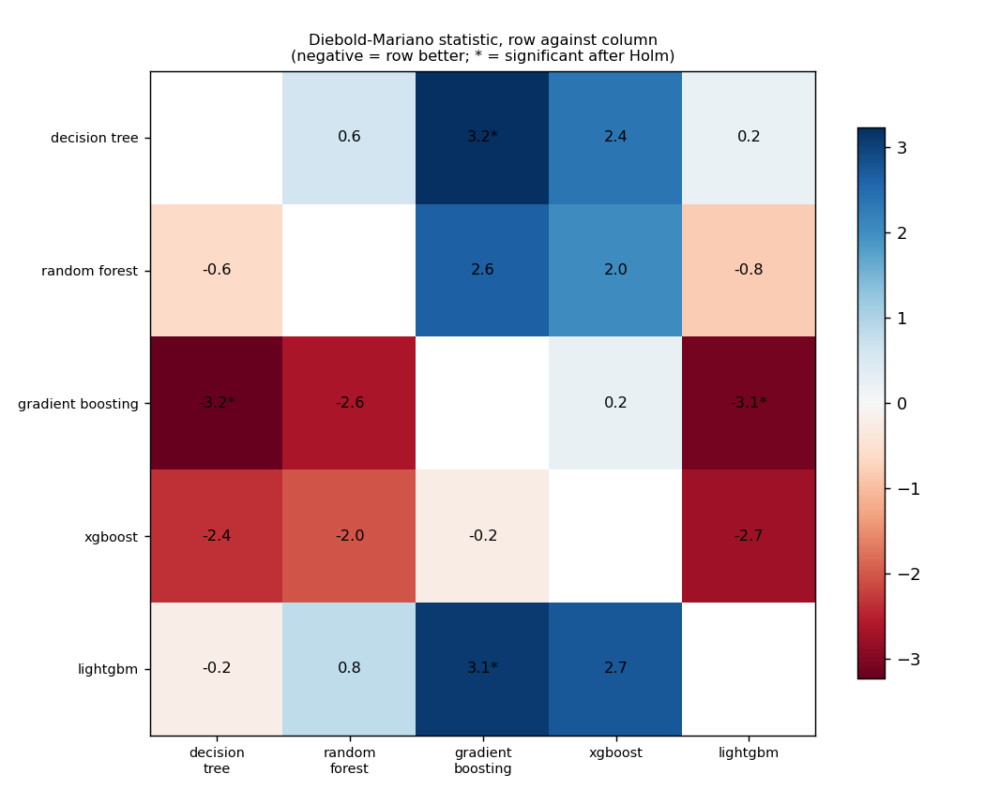
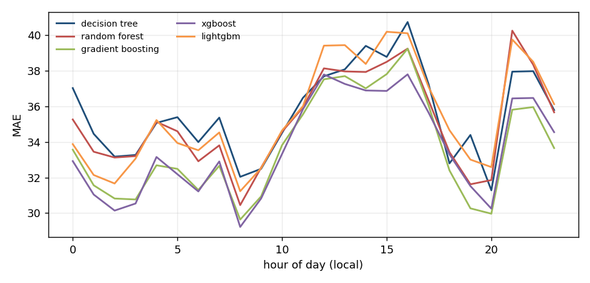
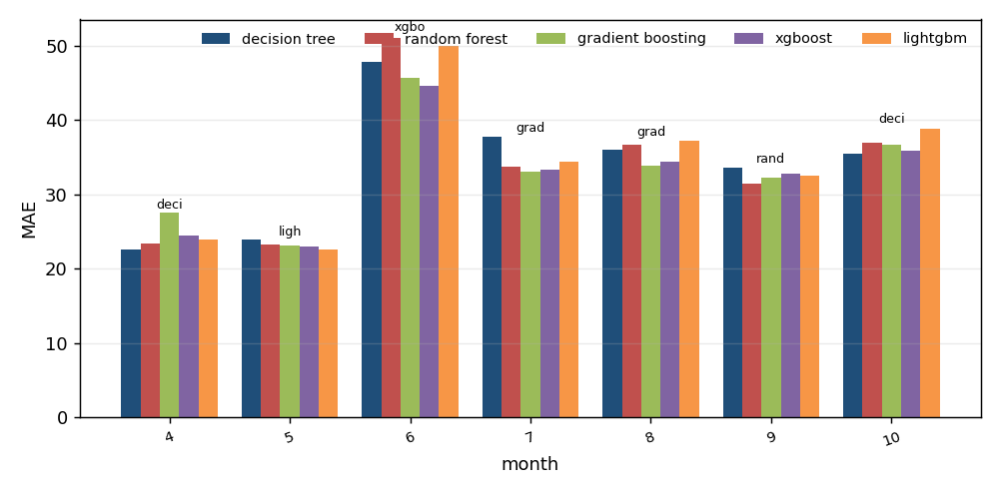
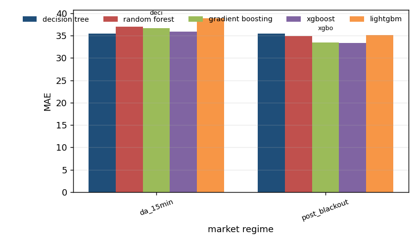

# Algorithm comparison: mfrr_price, development window

Generated by `tools/compare_algorithms.py`; do not edit by hand.

Algorithms: decision_tree, random_forest, gradient_boosting, xgboost, lightgbm. All are scored on the same 3,921 hours. Loss for the tests: absolute error, daily differences, Newey-West variance with 7 lags, Harvey-Leybourne-Newbold correction. A negative statistic means the first algorithm has the smaller loss.

## 1. Scoreboard

`days_best` is the share of delivery days on which the algorithm had the smallest daily MAE.

| model | n | sse | mae | rmse | days_best | mean_daily_rank |
|---|---|---|---|---|---|---|
| xgboost | 3921 | 6815423.576 | 33.658 | 41.692 | 0.281 | 2.719 |
| gradient_boosting | 3921 | 6673290.304 | 33.703 | 41.255 | 0.162 | 2.677 |
| random_forest | 3921 | 7315693.908 | 35.167 | 43.195 | 0.144 | 3.078 |
| lightgbm | 3921 | 7656900.238 | 35.469 | 44.190 | 0.216 | 3.174 |
| decision_tree | 3921 | 7491200.072 | 35.629 | 43.710 | 0.198 | 3.353 |

## 2. Every pair, with the Holm correction

2 of 10 pairs differ significantly at 5% after the Holm correction.

| a | b | n_days | mean_loss_a | mean_loss_b | statistic | p_value | p_holm | better |
|---|---|---|---|---|---|---|---|---|
| decision_tree | random_forest | 167 | 35.483 | 35.039 | 0.625 | 0.533 | 1.000 | random_forest |
| decision_tree | gradient_boosting | 167 | 35.483 | 33.623 | 3.232 | 0.001 | 0.015 | gradient_boosting |
| decision_tree | xgboost | 167 | 35.483 | 33.523 | 2.359 | 0.020 | 0.117 | xgboost |
| decision_tree | lightgbm | 167 | 35.483 | 35.317 | 0.214 | 0.831 | 1.000 | lightgbm |
| random_forest | gradient_boosting | 167 | 35.039 | 33.623 | 2.643 | 0.009 | 0.063 | gradient_boosting |
| random_forest | xgboost | 167 | 35.039 | 33.523 | 2.032 | 0.044 | 0.219 | xgboost |
| random_forest | lightgbm | 167 | 35.039 | 35.317 | -0.822 | 0.412 | 1.000 | random_forest |
| gradient_boosting | xgboost | 167 | 33.623 | 33.523 | 0.245 | 0.807 | 1.000 | xgboost |
| gradient_boosting | lightgbm | 167 | 33.623 | 35.317 | -3.087 | 0.002 | 0.021 | gradient_boosting |
| xgboost | lightgbm | 167 | 33.523 | 35.317 | -2.744 | 0.007 | 0.054 | xgboost |

## 3. Which algorithms cannot be told apart from the best

Best by mean loss: **xgboost**. Not distinguishable from it (Holm over the 4 comparisons with the best): **xgboost, decision_tree, random_forest, gradient_boosting**.

| model | mean_loss | best_loss | mean_diff | statistic | p_value | p_holm | distinguishable_from_best |
|---|---|---|---|---|---|---|---|
| decision_tree | 35.483 | 33.523 | 1.960 | 2.359 | 0.020 | 0.059 | False |
| random_forest | 35.039 | 33.523 | 1.515 | 2.032 | 0.044 | 0.087 | False |
| gradient_boosting | 33.623 | 33.523 | 0.100 | 0.245 | 0.807 | 0.807 | False |
| lightgbm | 35.317 | 33.523 | 1.794 | 2.744 | 0.007 | 0.027 | True |

## 4. Where each algorithm wins

`lowest_mae` is the algorithm with the smallest average error in the group; `winner` is the one that was best in the most units and `winner_share` the share of units it won (a unit is one day-hour for the hour table, one delivery day otherwise). The two can differ.

### By month of the year

| group | units | decision_tree | random_forest | gradient_boosting | xgboost | lightgbm | lowest_mae | winner | winner_share |
|---|---|---|---|---|---|---|---|---|---|
| 4 | 3 | 22.584 | 23.416 | 27.573 | 24.421 | 23.968 | decision_tree | decision_tree | 0.667 |
| 5 | 31 | 23.948 | 23.206 | 23.131 | 22.917 | 22.636 | lightgbm | xgboost | 0.290 |
| 6 | 30 | 47.845 | 50.995 | 45.716 | 44.642 | 50.017 | xgboost | xgboost | 0.400 |
| 7 | 31 | 37.701 | 33.668 | 33.081 | 33.257 | 34.447 | gradient_boosting | xgboost | 0.290 |
| 8 | 31 | 35.986 | 36.652 | 33.832 | 34.351 | 37.204 | gradient_boosting | lightgbm | 0.258 |
| 9 | 30 | 33.529 | 31.500 | 32.197 | 32.848 | 32.506 | random_forest | lightgbm | 0.267 |
| 10 | 11 | 35.457 | 37.004 | 36.681 | 35.830 | 38.852 | decision_tree | decision_tree | 0.364 |

### By market regime

| group | units | decision_tree | random_forest | gradient_boosting | xgboost | lightgbm | lowest_mae | winner | winner_share |
|---|---|---|---|---|---|---|---|---|---|
| da_15min | 11 | 35.457 | 37.004 | 36.681 | 35.830 | 38.852 | decision_tree | decision_tree | 0.364 |
| post_blackout | 156 | 35.485 | 34.900 | 33.407 | 33.360 | 35.067 | xgboost | xgboost | 0.288 |

### By hour of day

| group | units | decision_tree | random_forest | gradient_boosting | xgboost | lightgbm | lowest_mae | winner | winner_share |
|---|---|---|---|---|---|---|---|---|---|
| 0 | 165 | 37.018 | 35.256 | 33.559 | 32.919 | 33.873 | xgboost | xgboost | 0.273 |
| 1 | 166 | 34.449 | 33.446 | 31.562 | 31.043 | 32.140 | xgboost | decision_tree | 0.259 |
| 2 | 165 | 33.172 | 33.120 | 30.820 | 30.143 | 31.663 | xgboost | decision_tree | 0.297 |
| 3 | 162 | 33.263 | 33.200 | 30.766 | 30.539 | 33.060 | xgboost | decision_tree | 0.302 |
| 4 | 163 | 35.064 | 35.125 | 32.685 | 33.150 | 35.223 | gradient_boosting | decision_tree | 0.282 |
| 5 | 165 | 35.385 | 34.594 | 32.484 | 32.184 | 33.935 | xgboost | xgboost | 0.279 |
| 6 | 163 | 33.987 | 32.911 | 31.298 | 31.218 | 33.527 | xgboost | xgboost | 0.282 |
| 7 | 164 | 35.361 | 33.803 | 32.654 | 32.901 | 34.527 | gradient_boosting | lightgbm | 0.250 |
| 8 | 165 | 32.038 | 30.451 | 29.638 | 29.225 | 31.230 | xgboost | xgboost | 0.291 |
| 9 | 165 | 32.486 | 32.554 | 30.940 | 30.822 | 32.524 | xgboost | decision_tree | 0.291 |
| 10 | 164 | 34.502 | 34.573 | 33.815 | 33.320 | 34.638 | xgboost | decision_tree | 0.280 |
| 11 | 161 | 36.475 | 35.934 | 35.545 | 35.835 | 36.002 | gradient_boosting | decision_tree | 0.286 |
| 12 | 163 | 37.681 | 38.125 | 37.509 | 37.782 | 39.400 | gradient_boosting | decision_tree | 0.270 |
| 13 | 162 | 38.070 | 37.954 | 37.690 | 37.251 | 39.428 | xgboost | xgboost | 0.309 |
| 14 | 163 | 39.388 | 37.922 | 37.003 | 36.883 | 38.374 | xgboost | xgboost | 0.301 |
| 15 | 162 | 38.768 | 38.490 | 37.803 | 36.858 | 40.179 | xgboost | xgboost | 0.315 |
| 16 | 161 | 40.725 | 39.234 | 39.228 | 37.789 | 40.093 | xgboost | xgboost | 0.298 |
| 17 | 164 | 37.248 | 36.336 | 36.041 | 35.645 | 37.085 | xgboost | decision_tree | 0.244 |
| 18 | 161 | 32.792 | 33.423 | 32.395 | 33.293 | 34.654 | gradient_boosting | decision_tree | 0.329 |
| 19 | 161 | 34.387 | 31.619 | 30.268 | 31.519 | 33.005 | gradient_boosting | decision_tree | 0.255 |
| 20 | 163 | 31.282 | 31.856 | 29.968 | 30.253 | 32.584 | gradient_boosting | decision_tree | 0.301 |
| 21 | 163 | 37.940 | 40.239 | 35.803 | 36.438 | 39.742 | gradient_boosting | decision_tree | 0.344 |
| 22 | 165 | 37.967 | 38.329 | 35.952 | 36.463 | 38.494 | gradient_boosting | decision_tree | 0.279 |
| 23 | 165 | 35.784 | 35.657 | 33.651 | 34.544 | 36.116 | gradient_boosting | decision_tree | 0.273 |

Source run: `runtime/analysis/rollout/mfrr_price/tuned` (suffix `_tuned`).
