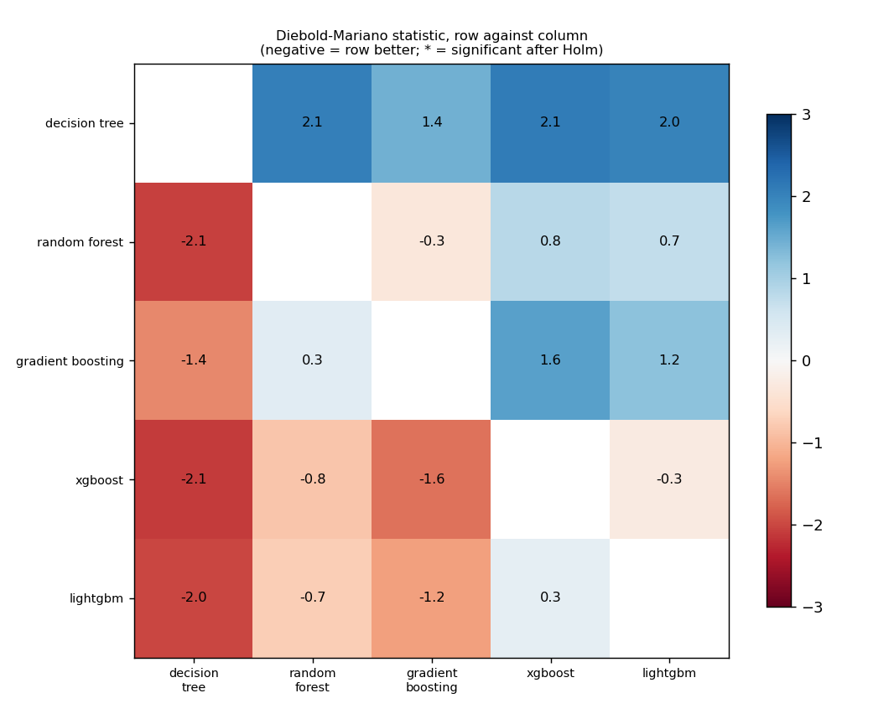
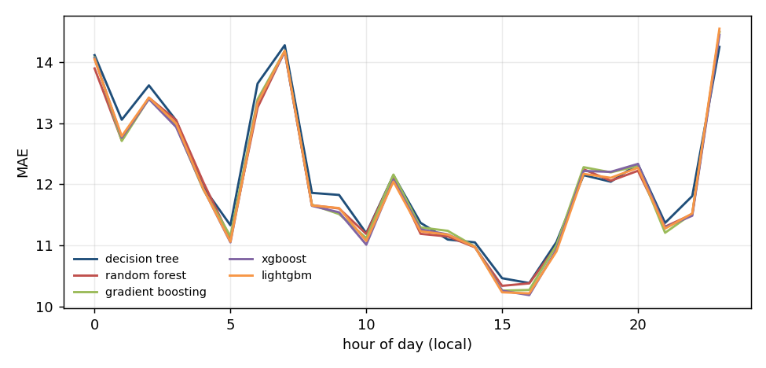
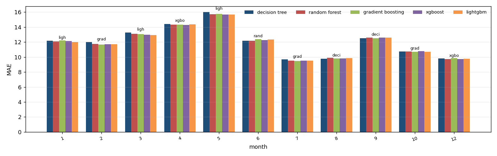
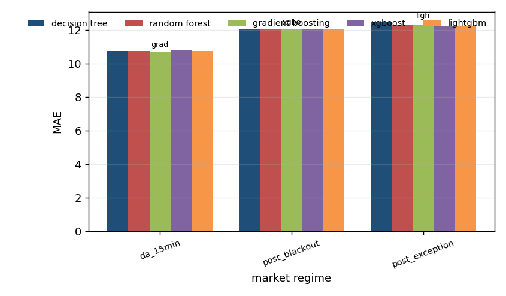

# Algorithm comparison: xbid_price, development window

Generated by `tools/compare_algorithms.py`; do not edit by hand.

Algorithms: decision_tree, random_forest, gradient_boosting, xgboost, lightgbm. All are scored on the same 5,783 hours. Loss for the tests: absolute error, daily differences, Newey-West variance with 7 lags, Harvey-Leybourne-Newbold correction. A negative statistic means the first algorithm has the smaller loss.

## 1. Scoreboard

`days_best` is the share of delivery days on which the algorithm had the smallest daily MAE.

| model | n | sse | mae | rmse | days_best | mean_daily_rank |
|---|---|---|---|---|---|---|
| xgboost | 5783 | 1838380.661 | 12.012 | 17.830 | 0.175 | 2.838 |
| lightgbm | 5783 | 1845094.079 | 12.014 | 17.862 | 0.149 | 3.003 |
| random_forest | 5783 | 1843978.514 | 12.031 | 17.857 | 0.211 | 2.964 |
| gradient_boosting | 5783 | 1842686.404 | 12.036 | 17.850 | 0.201 | 2.967 |
| decision_tree | 5783 | 1853413.602 | 12.121 | 17.902 | 0.264 | 3.228 |

## 2. Every pair, with the Holm correction

0 of 10 pairs differ significantly at 5% after the Holm correction.

| a | b | n_days | mean_loss_a | mean_loss_b | statistic | p_value | p_holm | better |
|---|---|---|---|---|---|---|---|---|
| decision_tree | random_forest | 303 | 12.196 | 12.116 | 2.062 | 0.040 | 0.367 | random_forest |
| decision_tree | gradient_boosting | 303 | 12.196 | 12.126 | 1.434 | 0.153 | 0.916 | gradient_boosting |
| decision_tree | xgboost | 303 | 12.196 | 12.094 | 2.098 | 0.037 | 0.367 | xgboost |
| decision_tree | lightgbm | 303 | 12.196 | 12.099 | 1.997 | 0.047 | 0.374 | lightgbm |
| random_forest | gradient_boosting | 303 | 12.116 | 12.126 | -0.335 | 0.738 | 1.000 | random_forest |
| random_forest | xgboost | 303 | 12.116 | 12.094 | 0.840 | 0.402 | 1.000 | xgboost |
| random_forest | lightgbm | 303 | 12.116 | 12.099 | 0.729 | 0.466 | 1.000 | lightgbm |
| gradient_boosting | xgboost | 303 | 12.126 | 12.094 | 1.638 | 0.102 | 0.717 | xgboost |
| gradient_boosting | lightgbm | 303 | 12.126 | 12.099 | 1.223 | 0.222 | 1.000 | lightgbm |
| xgboost | lightgbm | 303 | 12.094 | 12.099 | -0.266 | 0.790 | 1.000 | xgboost |

## 3. Which algorithms cannot be told apart from the best

Best by mean loss: **xgboost**. Not distinguishable from it (Holm over the 4 comparisons with the best): **xgboost, decision_tree, random_forest, gradient_boosting, lightgbm**.

| model | mean_loss | best_loss | mean_diff | statistic | p_value | p_holm | distinguishable_from_best |
|---|---|---|---|---|---|---|---|
| decision_tree | 12.196 | 12.094 | 0.102 | 2.098 | 0.037 | 0.147 | False |
| random_forest | 12.116 | 12.094 | 0.021 | 0.840 | 0.402 | 0.803 | False |
| gradient_boosting | 12.126 | 12.094 | 0.031 | 1.638 | 0.102 | 0.307 | False |
| lightgbm | 12.099 | 12.094 | 0.004 | 0.266 | 0.790 | 0.803 | False |

## 4. Where each algorithm wins

`lowest_mae` is the algorithm with the smallest average error in the group; `winner` is the one that was best in the most units and `winner_share` the share of units it won (a unit is one day-hour for the hour table, one delivery day otherwise). The two can differ.

### By month of the year

| group | units | decision_tree | random_forest | gradient_boosting | xgboost | lightgbm | lowest_mae | winner | winner_share |
|---|---|---|---|---|---|---|---|---|---|
| 1 | 31 | 12.163 | 12.084 | 12.201 | 12.123 | 12.008 | lightgbm | lightgbm | 0.323 |
| 2 | 28 | 11.997 | 11.752 | 11.666 | 11.730 | 11.710 | gradient_boosting | gradient_boosting | 0.286 |
| 3 | 31 | 13.259 | 13.112 | 13.067 | 12.973 | 12.952 | lightgbm | random_forest | 0.258 |
| 4 | 29 | 14.400 | 14.303 | 14.310 | 14.289 | 14.356 | xgboost | decision_tree | 0.345 |
| 5 | 31 | 15.989 | 15.728 | 15.772 | 15.686 | 15.675 | lightgbm | random_forest | 0.290 |
| 6 | 30 | 12.184 | 12.181 | 12.394 | 12.256 | 12.355 | random_forest | decision_tree | 0.300 |
| 7 | 31 | 9.688 | 9.531 | 9.489 | 9.515 | 9.529 | gradient_boosting | random_forest | 0.323 |
| 8 | 31 | 9.774 | 9.888 | 9.826 | 9.821 | 9.841 | decision_tree | decision_tree | 0.290 |
| 9 | 30 | 12.499 | 12.597 | 12.502 | 12.585 | 12.586 | decision_tree | gradient_boosting | 0.333 |
| 10 | 11 | 10.722 | 10.751 | 10.711 | 10.776 | 10.720 | gradient_boosting | random_forest | 0.364 |
| 12 | 20 | 9.823 | 9.747 | 9.843 | 9.721 | 9.769 | xgboost | decision_tree | 0.350 |

### By market regime

| group | units | decision_tree | random_forest | gradient_boosting | xgboost | lightgbm | lowest_mae | winner | winner_share |
|---|---|---|---|---|---|---|---|---|---|
| da_15min | 11 | 10.722 | 10.751 | 10.711 | 10.776 | 10.720 | gradient_boosting | random_forest | 0.364 |
| post_blackout | 155 | 12.075 | 12.050 | 12.068 | 12.048 | 12.071 | xgboost | decision_tree | 0.252 |
| post_exception | 137 | 12.452 | 12.300 | 12.305 | 12.253 | 12.241 | lightgbm | decision_tree | 0.292 |

### By hour of day

| group | units | decision_tree | random_forest | gradient_boosting | xgboost | lightgbm | lowest_mae | winner | winner_share |
|---|---|---|---|---|---|---|---|---|---|
| 0 | 140 | 14.116 | 13.899 | 14.079 | 14.065 | 14.049 | random_forest | decision_tree | 0.386 |
| 1 | 192 | 13.058 | 12.722 | 12.710 | 12.763 | 12.789 | gradient_boosting | decision_tree | 0.312 |
| 2 | 223 | 13.621 | 13.419 | 13.405 | 13.397 | 13.421 | xgboost | decision_tree | 0.318 |
| 3 | 236 | 13.049 | 13.053 | 12.956 | 12.940 | 12.999 | xgboost | decision_tree | 0.381 |
| 4 | 242 | 11.958 | 12.038 | 11.915 | 11.933 | 11.931 | gradient_boosting | decision_tree | 0.397 |
| 5 | 243 | 11.330 | 11.114 | 11.153 | 11.050 | 11.062 | xgboost | decision_tree | 0.354 |
| 6 | 237 | 13.651 | 13.260 | 13.394 | 13.341 | 13.335 | random_forest | decision_tree | 0.342 |
| 7 | 238 | 14.279 | 14.181 | 14.187 | 14.168 | 14.187 | xgboost | decision_tree | 0.349 |
| 8 | 252 | 11.861 | 11.659 | 11.666 | 11.648 | 11.653 | xgboost | decision_tree | 0.313 |
| 9 | 231 | 11.827 | 11.605 | 11.514 | 11.542 | 11.612 | gradient_boosting | decision_tree | 0.316 |
| 10 | 237 | 11.201 | 11.188 | 11.121 | 11.013 | 11.074 | xgboost | decision_tree | 0.363 |
| 11 | 263 | 12.150 | 12.139 | 12.161 | 12.077 | 12.046 | lightgbm | decision_tree | 0.342 |
| 12 | 207 | 11.370 | 11.190 | 11.295 | 11.263 | 11.232 | random_forest | decision_tree | 0.314 |
| 13 | 220 | 11.097 | 11.147 | 11.239 | 11.181 | 11.178 | decision_tree | decision_tree | 0.359 |
| 14 | 217 | 11.050 | 10.970 | 10.981 | 10.975 | 10.975 | random_forest | decision_tree | 0.369 |
| 15 | 239 | 10.463 | 10.339 | 10.260 | 10.259 | 10.233 | lightgbm | decision_tree | 0.331 |
| 16 | 240 | 10.384 | 10.379 | 10.271 | 10.187 | 10.215 | xgboost | decision_tree | 0.358 |
| 17 | 240 | 11.056 | 10.988 | 11.004 | 10.931 | 10.901 | lightgbm | decision_tree | 0.346 |
| 18 | 261 | 12.151 | 12.247 | 12.282 | 12.219 | 12.172 | decision_tree | decision_tree | 0.372 |
| 19 | 282 | 12.044 | 12.059 | 12.197 | 12.205 | 12.107 | decision_tree | decision_tree | 0.379 |
| 20 | 285 | 12.332 | 12.223 | 12.302 | 12.335 | 12.272 | random_forest | decision_tree | 0.305 |
| 21 | 280 | 11.369 | 11.307 | 11.208 | 11.298 | 11.276 | gradient_boosting | decision_tree | 0.296 |
| 22 | 286 | 11.809 | 11.511 | 11.521 | 11.487 | 11.524 | xgboost | decision_tree | 0.283 |
| 23 | 292 | 14.251 | 14.498 | 14.491 | 14.449 | 14.550 | decision_tree | decision_tree | 0.377 |

Source run: `runtime/analysis/rollout/xbid_price/tuned` (suffix `_tuned`).
