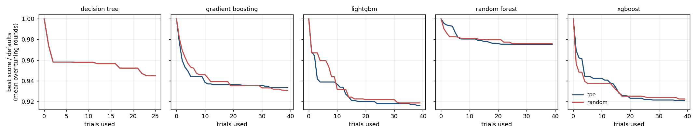
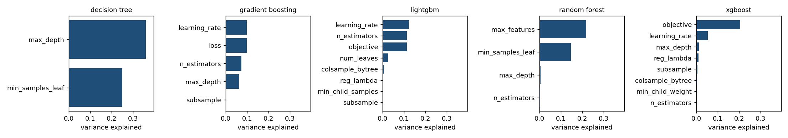
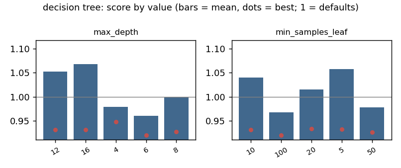
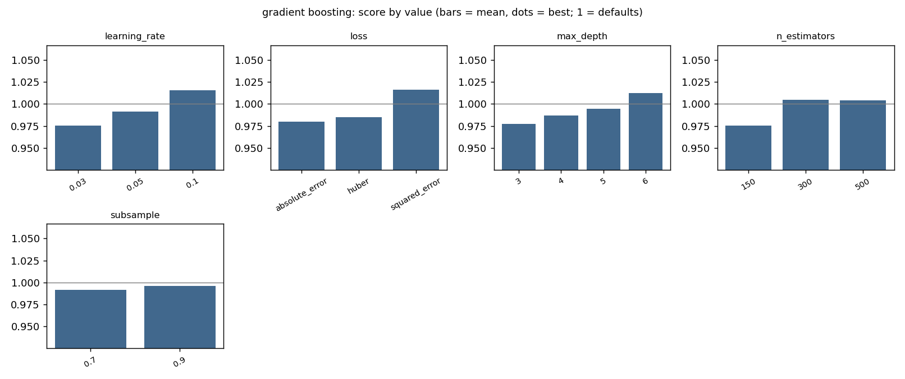
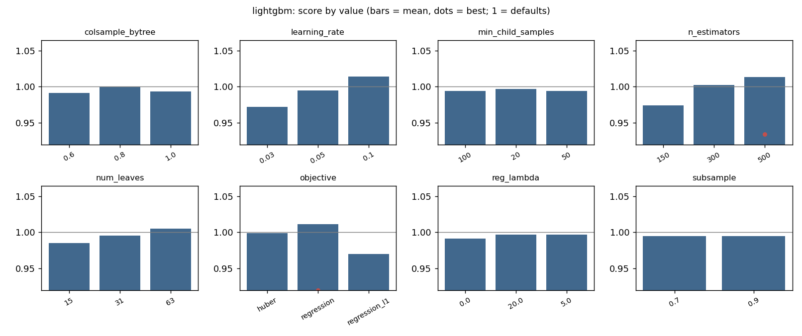
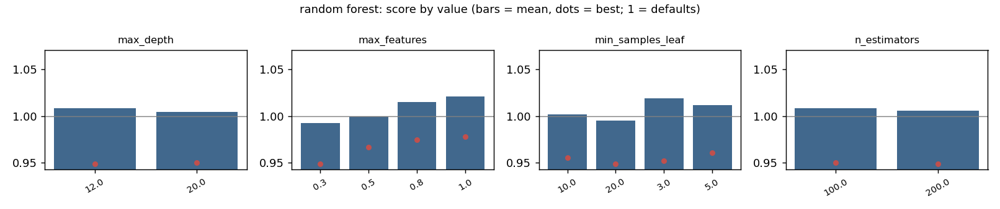
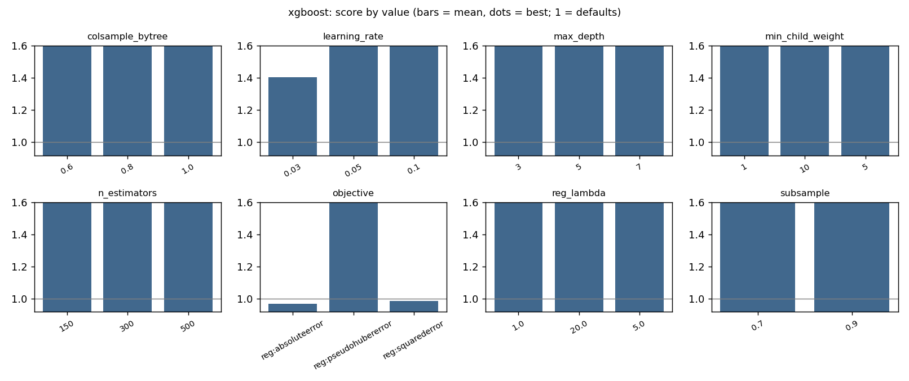
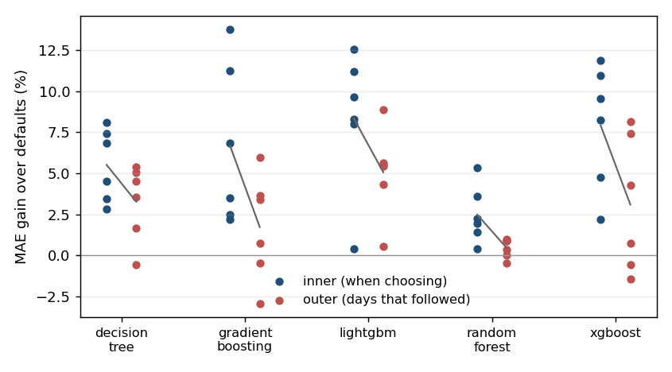

# Tuning evidence: da_price, development window

Generated by `tools/make_tuning_evidence.py` from the trial logs of the runs named below; do not edit by hand.
Scores are mean absolute error in price units; a *relative score* is a trial's score divided by the score of the algorithm's defaults in the same tuning round (below 1 beats the defaults).

## 1. How fast the search converges

Best relative score after k trials, mean over the tuning rounds (one line per search method, same budget).

| search | model | after 10 trials | after 20 | after 40 | rounds |
|---|---|---|---|---|---|
| random | decision_tree | 0.958 | 0.952 | 0.945 | 6 |
| tpe | decision_tree | 0.958 | 0.952 | 0.945 | 6 |
| random | gradient_boosting | 0.946 | 0.935 | 0.931 | 6 |
| tpe | gradient_boosting | 0.939 | 0.936 | 0.933 | 6 |
| random | lightgbm | 0.932 | 0.922 | 0.919 | 6 |
| tpe | lightgbm | 0.937 | 0.920 | 0.916 | 6 |
| random | random_forest | 0.981 | 0.980 | 0.976 | 6 |
| tpe | random_forest | 0.980 | 0.976 | 0.975 | 6 |
| random | xgboost | 0.938 | 0.925 | 0.923 | 6 |
| tpe | xgboost | 0.942 | 0.923 | 0.921 | 6 |

## 2. Which settings matter

Share of the variance of the relative score explained by each setting, from the uniformly drawn trials of the random-search control (marginal, not an interaction analysis).

## 3. What was chosen, and how stable it is

Share of tuning rounds that chose the most frequent value of a setting (1.0 = the same value every round).

| search | model | setting | rounds | most_frequent | share_most_frequent |
|---|---|---|---|---|---|
| tpe | decision_tree | max_depth | 6 | 6 | 0.667 |
| tpe | decision_tree | min_samples_leaf | 6 | 100 | 0.500 |
| tpe | gradient_boosting | learning_rate | 6 | 0.03 | 0.500 |
| tpe | gradient_boosting | loss | 6 | absolute_error | 0.500 |
| tpe | gradient_boosting | max_depth | 6 | 3 | 0.500 |
| tpe | gradient_boosting | n_estimators | 6 | 150 | 0.833 |
| tpe | gradient_boosting | subsample | 6 | 0.9 | 0.500 |
| tpe | lightgbm | colsample_bytree | 6 | 0.8 | 0.333 |
| tpe | lightgbm | learning_rate | 6 | 0.03 | 0.667 |
| tpe | lightgbm | min_child_samples | 6 | 100 | 0.333 |
| tpe | lightgbm | n_estimators | 6 | 150 | 0.833 |
| tpe | lightgbm | num_leaves | 6 | 15 | 0.667 |
| tpe | lightgbm | objective | 6 | regression_l1 | 0.667 |
| tpe | lightgbm | reg_lambda | 6 | 0.0 | 0.500 |
| tpe | lightgbm | subsample | 6 | 0.7 | 0.667 |
| tpe | random_forest | max_depth | 6 | 12 | 0.500 |
| tpe | random_forest | max_features | 6 | 0.5 | 0.667 |
| tpe | random_forest | min_samples_leaf | 6 | 20 | 0.667 |
| tpe | random_forest | n_estimators | 6 | 100 | 0.833 |
| tpe | xgboost | colsample_bytree | 6 | 1.0 | 0.500 |
| tpe | xgboost | learning_rate | 6 | 0.05 | 0.500 |
| tpe | xgboost | max_depth | 6 | 3 | 0.667 |
| tpe | xgboost | min_child_weight | 6 | 10 | 0.500 |
| tpe | xgboost | n_estimators | 6 | 150 | 0.500 |
| tpe | xgboost | objective | 6 | reg:absoluteerror | 0.500 |
| tpe | xgboost | reg_lambda | 6 | 20.0 | 0.500 |
| tpe | xgboost | subsample | 6 | 0.7 | 0.667 |
| random | decision_tree | max_depth | 6 | 6 | 0.667 |
| random | decision_tree | min_samples_leaf | 6 | 100 | 0.500 |
| random | gradient_boosting | learning_rate | 6 | 0.05 | 0.667 |
| random | gradient_boosting | loss | 6 | squared_error | 0.333 |
| random | gradient_boosting | max_depth | 6 | 3 | 0.500 |
| random | gradient_boosting | n_estimators | 6 | 150 | 0.833 |
| random | gradient_boosting | subsample | 6 | 0.7 | 0.667 |
| random | lightgbm | (defaults) | 1 |  | 1.000 |
| random | lightgbm | colsample_bytree | 5 | 0.6 | 0.400 |
| random | lightgbm | learning_rate | 5 | 0.03 | 0.800 |
| random | lightgbm | min_child_samples | 5 | 100 | 0.800 |
| random | lightgbm | n_estimators | 5 | 150 | 0.800 |
| random | lightgbm | num_leaves | 5 | 15 | 0.400 |
| random | lightgbm | objective | 5 | regression_l1 | 0.800 |
| random | lightgbm | reg_lambda | 5 | 20.0 | 0.400 |
| random | lightgbm | subsample | 5 | 0.7 | 0.600 |
| random | random_forest | max_depth | 6 | 12 | 0.667 |
| random | random_forest | max_features | 6 | 0.5 | 0.667 |
| random | random_forest | min_samples_leaf | 6 | 20 | 0.667 |
| random | random_forest | n_estimators | 6 | 200 | 0.500 |
| random | xgboost | colsample_bytree | 6 | 0.6 | 0.500 |
| random | xgboost | learning_rate | 6 | 0.03 | 0.500 |
| random | xgboost | max_depth | 6 | 3 | 0.667 |
| random | xgboost | min_child_weight | 6 | 1 | 0.333 |
| random | xgboost | n_estimators | 6 | 150 | 0.500 |
| random | xgboost | objective | 6 | reg:absoluteerror | 0.667 |
| random | xgboost | reg_lambda | 6 | 20.0 | 0.500 |
| random | xgboost | subsample | 6 | 0.9 | 0.500 |

## 4. The gain seen when choosing against the gain afterwards

Inner = gain of the chosen setting over the defaults on the validation blocks it was chosen on. Outer = gain on the days that then used it (compared with the untuned model on the same days). Gap = outer MAE of the tuned model minus the inner score.

| model | inner_gain | outer_gain | mean_gap | rounds |
|---|---|---|---|---|
| decision_tree | 0.055 | 0.033 | -0.675 | 6 |
| gradient_boosting | 0.067 | 0.017 | -0.699 | 6 |
| lightgbm | 0.084 | 0.051 | -0.741 | 6 |
| random_forest | 0.025 | 0.004 | -1.035 | 6 |
| xgboost | 0.079 | 0.031 | -0.658 | 6 |

## 5. Pruning in the Optuna search

| model | trials | pruned | duplicates | share_pruned |
|---|---|---|---|---|
| decision_tree | 156 | 0 | 0 | 0.000 |
| gradient_boosting | 240 | 95 | 56 | 0.396 |
| lightgbm | 240 | 87 | 30 | 0.362 |
| random_forest | 240 | 81 | 60 | 0.338 |
| xgboost | 240 | 94 | 19 | 0.392 |

## Source runs

- Optuna: `runtime/analysis/phase9/da_stage2_tpe_v2`
- random control: `runtime/analysis/phase9/da_stage2_random_v2`
- untuned: `runtime/analysis/phase9/da_untuned`
