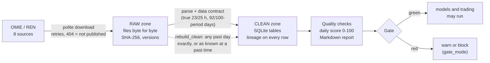

# Phase 1 — Daily data pipeline

Every trading and forecasting phase in this repository starts from market data (day-ahead, intraday, continuous
market, aFRR, mFRR and imbalance prices from OMIE and REN). Phase 1 is the part that makes that data **trustworthy
and reproducible**: it downloads what is new, keeps the original files untouched, builds validated tables, scores
their quality every day, and stops a model run when the data is not good enough.

> **Numbering.** Pipeline phases are numbered in execution order: 1 data pipeline, 2 day-ahead, 3 intraday
> (3A–3D), 4 reserve offers, 5 real-time and activation, 6 settlement and analytics, 7 backtesting. The separate
> forecasting programme (`docs/ML_Forecasting_Plan.pdf`, steps 0–17) has its own step numbers; its steps 2 and 3
> (data layer, data quality) are what this phase implements.

```bash
python phase_1_data_pipeline/run_data_pipeline.py --demo      # offline: replays a real 25-hour day, no network
python phase_1_data_pipeline/run_data_pipeline.py             # real daily run (about 1 request per second)
python phase_1_data_pipeline/run_data_pipeline.py --dry-run   # show which days it would ask each source for
python run_production.py                                      # runs this as phase 1, then the trading phases
```

## What one run does



| Zone | Rule | Why it matters |
|---|---|---|
| **Raw** | written once, never edited; every file has a SHA-256 in a manifest; a revised source file becomes version 2 and version 1 stays | any number can be traced to the exact bytes it came from; "what did we know on that morning?" can be answered |
| **Clean** | one table per dataset, one transaction per delivery day, rows carry the raw checksum and parser version | rebuilding from raw gives a bit-identical table (tested) |
| **Quality** | checks, daily score, report, gate | a red gate means no model run on bad data |

## Design decisions worth knowing

* **True time.** Delivery days follow Europe/Madrid; every period carries its UTC start. The two daylight-saving
  days keep their real length (23 or 25 hours; 92 or 100 quarter-hours) and the autumn day has two distinct
  "hour 3" slots. The optimiser's fixed 24/96-slot grid is produced in one documented function
  (`common_layer/data_layer/calendar.py: to_model_grid`).
* **Market regimes are data.** Dated rule changes (three intraday auctions from 2024-06-13, 15-minute settlement,
  15-minute day-ahead from 2025-10-01, price-floor change, platform deadlines) are in `config/market_regimes.yaml`
  so a row can be stamped with the rules it was generated under.
* **Spikes and negative prices are information.** They are counted per day and never removed or penalised.
* **Rules were tested on real data and corrected.** A "six identical hours = stuck feed" rule fired on genuine
  prices (the Portuguese day-ahead price really sat at 1.95 EUR/MWh for up to 9 hours in 2020-2021); it became
  "a whole day constant" plus a "day identical to yesterday's" check. See `docs/forecasting/Phase3_Data_Quality.md`.
* **Imputation never looks forward.** Per-variable fill rules are written in `config/data_quality.yaml`, filled
  values are marked, and a test proves later data cannot change earlier filled values.
* **Idempotent and safe to repeat.** Stored days are skipped; the last two days are re-checked because OMIE
  re-issues files; a lock stops two runs overlapping.

## Cleaning and filling (step 4, the data curation)

The clean zone keeps exactly what the sources published. After the checks, the curation (`common_layer/data_quality/curation.py`,
rules in `config/data_curation.yaml`) removes data errors (a value outside its legal range, a day with one value all day, a copy of the
day before, a level jump of 20 times or more) and fills every missing hour by the rule of its series: a gap of up to three hours by a
straight line, a longer one by the same hour a week earlier, band prices by carrying the last value forward first, and the intraday
prices by the day-ahead price plus the typical spread of that hour (so an empty auction becomes the day-ahead price). Genuine spikes and
negative prices are kept; hours an auction does not cover by design (IDA3 trades only the afternoon) are never filled; nothing is filled
before a series starts. Every filled value is flagged and counted per series (`curation_summary.csv`, `curation_gaps.csv`). The live
pipeline, the champions' fits and the monitoring read the curated panel (`build_panel(clean, curate=True)`); the model-development
evaluation scores the published values only.

## The gate

In `repair` mode (`config/data_quality.yaml: gate.mode`, the default) missing and bad days are repaired by the curation and are listed
as repairs, not failures. The gate is red only if more than 25 % of a dataset's days are missing (too little real data to repair from), a
feed is more than seven days beyond its allowed lag, or a raw checksum fails. In `strict` mode green requires, for every dataset:
missing days within the limit (2 %; intraday auctions 6 %, continuous market 5 %), mean daily score at least 95 with at most 2 % of days
below 70, no stale feed, and all raw checksums valid.
`config/data_pipeline.yaml: gate_mode` decides what red does inside `run_production.py`:

| gate_mode | red gate means |
|---|---|
| `warn` (current default) | phase 1 reports `DATA_WARN`; trading phases still run, because the optimiser and the older forecasters still read their own loaders |
| `block` | phase 1 fails and the run aborts before any trading phase |

Model code should call `common_layer.data_quality.runner.require_green()` first; it raises when the gate is red,
missing or older than 26 hours.

## Reading the report

`runtime/reports/data_quality_<date>.md` (generated by every run; the offline demo writes one too):

| Section | Meaning |
|---|---|
| Gate | GREEN or RED, with the reasons |
| Datasets | per dataset (per session for intraday auctions): days checked, missing share, mean score |
| Warnings by check | which checks fired, on how many days |
| Missing days | grouped into ranges, with what the source answered (`not_published`, `empty_publication`, `not_attempted`) |
| Lowest-scoring days | the worst days and their number of warnings |
| Information | spikes, negative prices and prices at the market limit per year: counted, never penalised |

## Scheduling

Sources publish at different times (tomorrow's day-ahead around 13:00 CET), so run twice a day; the second run
costs almost nothing.

| Where | How |
|---|---|
| Windows | `schedule/register_windows_tasks.ps1` (prints the plan; add `-Register` to create the two tasks) |
| Linux / macOS | `schedule/crontab.example` |
| Container | `docker run --rm -v "$PWD/runtime:/app/runtime" <image> python phase_1_data_pipeline/run_data_pipeline.py` |

## Continuous integration

`.github/workflows/data-pipeline.yml` runs the data-layer, data-quality and phase-1 tests and the offline demo on
every change, and publishes the demo's quality report in the run summary. The demo needs no network and no
market-data licence: it replays real files saved in `tests/fixtures/raw` for the 25-hour day 2025-10-26.

## Where the code lives

| Piece | Location |
|---|---|
| Orchestration, CLI, demo, `run_production` hook | `phase_1_data_pipeline/` |
| Library: zones, parsers, contracts, ingestion | `common_layer/data_layer/` |
| Library: checks, score, gate, imputation, provenance | `common_layer/data_quality/` |
| Settings | `config/data_pipeline.yaml`, `config/data_quality.yaml`, `config/market_regimes.yaml` |
| Background and findings | `docs/forecasting/Phase2_Data_Layer.md`, `docs/forecasting/Phase3_Data_Quality.md` |

The libraries stay in `common_layer/` because the other phases and the forecasting programme import them there.

## Limits

* Market data from OMIE and REN is not stored in this repository: their terms of use have not been verified yet.
  The repository holds the code, tests, small saved fixtures and the generated reports.
* Quality thresholds are starting values to be reviewed against the first complete history report.
* REN's endpoints are an internal website API with no published service level; a changed field name makes a day
  fail loudly (rejected, logged), not silently.
